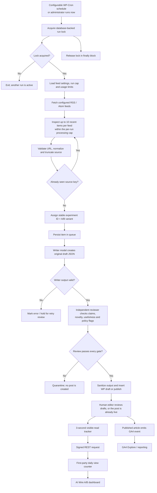
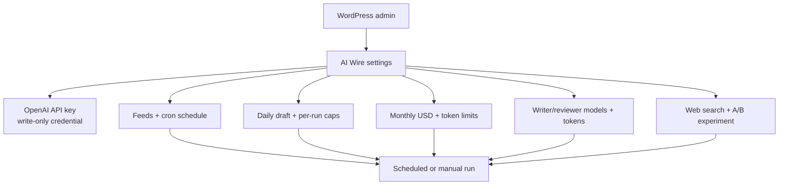
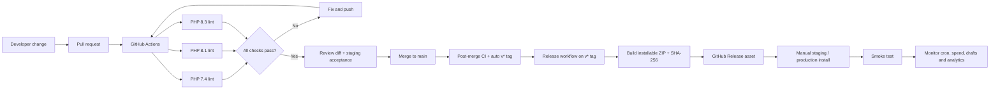

# AI Wire

Open-source WordPress plugin (**GPLv2 or later**) that turns **your** RSS/Atom feeds into source-attributed, AI-reviewed posts, then can optionally post a branded graphic, a spoken Instagram Reel, and a YouTube Short to **your** accounts.

It is not tied to one newsroom. Site name, desks, and the social poster brand mark come from the WordPress site that installed the plugin. You bring the feeds, OpenAI key, and social apps. See [Contributing](CONTRIBUTING.md) and [What it costs to run](docs/PLATFORM-COSTS.md).

Each item passes a writer and a separate editorial review. Thin blurbs, deal lists, coupons, best-of lists, and recaps are held. The reviewer also has to mark the story solid enough that readers would look for it. Items that clear those checks are **published automatically**. Uncheck **Auto-publish** if you want WordPress drafts instead.

> AI review is a quality gate, not a guarantee of factual accuracy or legal clearance. Rejected items stay quarantined.

For a role-by-role execution diagram, see [AI Agent Workflow and Feature Audit](docs/AI-AGENT-WORKFLOW-AUDIT.md). For post-publication X, Instagram, Reels, and YouTube Shorts, see [Social Distribution Architecture](docs/SOCIAL-DISTRIBUTION-ARCHITECTURE.md). For OpenAI vs X credits vs Instagram quota vs YouTube quota vs Fal, see [What it costs to run](docs/PLATFORM-COSTS.md). Ready-to-paste public copy is in [Announcement](docs/ANNOUNCEMENT.md).

## End-to-end pipeline

The diagram below shows the normal scheduled/manual path, the editorial gate, and the reader-measurement path. The processing interval and per-run workload cap are selected in the WordPress **AI Wire** dashboard.



### Pipeline stages and safety boundaries

| Stage | What happens | Guardrail |
|---|---|---|
| Trigger | Configurable WP-Cron interval or an administrator-triggered run | A database-backed lock serializes runs |
| Ingestion | Fetch configured RSS/Atom feeds and inspect up to 10 recent items per feed | HTTP(S) URL validation, source-key deduplication, source-size cap |
| Assignment | Stable A/B assignment from the source key; comic vs straight from the daily comic cap | Retries keep the same experiment, variant, and voice |
| Generation | Writer produces title, lede, body, category and tags | Source content is treated as untrusted input |
| Review | Separate model evaluates factual consistency, novelty, usefulness and policy flags | Fail closed: only explicit passing output proceeds |
| Policy scan | Local profanity/slur list plus OpenAI Moderation on the article and on every social caption, Reel script, YouTube title/description/tags, and on-image line | Fail closed: violating copy is quarantined or held for review, never posted |
| Draft or publish | Sanitized content is published automatically, or saved as a draft if Auto-publish is unchecked | Reject stays quarantined |
| Measurement | GA4 event plus first-party 3-second visible-read counter | Signed REST payload, per-session browser dedupe, no IP storage |
| Analysis | WordPress dashboard and GA4 Explore | Do not infer revenue or SEO lift from draft counts or a small sample |

## WordPress dashboard configuration

The **AI Wire** menu in wp-admin is the single place to configure credentials, feed ingestion, scheduling, processing limits, model selection, web search and editorial experiments. The API key uses a separate save action; all other settings are saved together. The manual-run action enqueues background work and returns immediately; it does not keep the administrator request open during feed/API processing.



## Production-readiness status

Upload the plugin zip in wp-admin and activate it. A fresh install stays **paused**: no API key, no feeds, schedule Manual only, daily cap `0`, and Social distribution **off**. Raise the daily cap and add a key only when you are ready to process. X, Instagram, and YouTube stay disconnected and posting stays off until you onboard each network.

The plugin release is **not considered production-validated until the staging acceptance checklist has passed on the target WordPress host**. Version 0.2.0 adds background enqueueing for manual runs, scheduled bounded retries, permanent-vs-transient API error handling, an idempotent draft recovery path, atomic stale-lock deletion/heartbeat handling, and an atomic database-backed public-view rate limiter. The schema migration creates the rate-limit table without dropping existing queue/view data.

Automated WordPress integration tests now exercise selected critical paths. They do not prove the production host's cron runner, outbound networking, database upgrade behavior on a copy of the live database, proxy/IP configuration, or end-to-end analytics. Auto-publish is on; uncheck it if you want a human publish step. Complete the staging runbook before enabling a busy schedule.

## Install and configure

1. Upload the plugin ZIP through **Plugins → Add New → Upload Plugin**, or copy the plugin directory to `wp-content/plugins/technorapper-ai-wire/`.
2. Activate the plugin. The plugin creates/updates its queue and view tables and schedules its initial processing run.
3. Open **AI Wire** in wp-admin. This is the central configuration screen: enter the API key, choose the processing schedule, add feeds, set daily/monthly limits, choose models, and configure editorial and analytics options.
4. Save the API key in the **OpenAI API connection** section. The key is stored separately in a non-autoloaded WordPress option, never shown again in the form, and can be replaced or removed there. A key supplied through `OPENAI_API_KEY` or `TR_AI_WIRE_OPENAI_API_KEY` in `wp-config.php` remains supported as a fallback. Dashboard key takes precedence.
5. Save the remaining configuration using **Save settings**. Use **Fetch feeds and process queue now** to queue a background worker. The page stays open and a progress bar tracks fetch, rewrite, and review. Scheduled runs still use WP-Cron.
6. Inspect **AI Wire → Queue & usage**. Passing items go live when **Auto-publish** is checked (the default). Uncheck it to keep drafts. **Retry**, **Stop current run**, **Clear unfinished**, **Clean board**, and a row **Delete** stay on the page: long work shows the progress bar, and delete or clean updates the table in place. WordPress posts stay.

### Dashboard configuration reference

All day-to-day settings are available in one place under **AI Wire**:

| Setting | What it controls |
|---|---|
| OpenAI API key | Credential used for writer and reviewer requests; saved separately from ordinary settings |
| Automatic processing schedule | Hourly, every 3, 6 or 12 hours, daily, or manual-only |
| Feed tenants | Each RSS/Atom feed is onboarded as its own tenant in wp-admin. The plugin does not ship any feeds; add the URLs you want |
| Maximum posts per day | Daily draft and auto-published post cap; `0` pauses creation |
| Maximum items per run | Caps the number of queued retries and new feed items processed in one scheduled/manual run (1–100) |
| Monthly API budget | Local estimated USD spend ceiling; `0` stops AI calls |
| Monthly token limit | This plugin's combined monthly input/output token ceiling. Separate from the OpenAI credit balance and project budget. Default is 200,000,000. `0` stops AI calls |
| Maximum output tokens | Per AI pass output ceiling |
| Maximum source characters | Source text truncation limit before AI processing |
| Writer and reviewer models | Model selection for the two editorial passes |
| Independent web search | Optional reviewer corroboration and associated search charges |
| Editorial A/B experiment | Enables/disables stable A/B writer assignment and sets the experiment ID |
| Comic posts per day | How many articles today (UTC) get the dry comic voice; the rest stay straight so you can compare them on A/B experiments. `0` turns comic off |
| Social distribution | Opt-in switch, maximum daily article count (up to 10), social stills score floor (default 90), and monthly social-image budget |
| Auto-publish | When checked, passing items go live with no draft step |
| Show on homepage | On puts new posts on the home board (desk, image, sticky). Off keeps them on their own link and hides them from the home feed |
| Map content | Post type, taxonomy, optional forced terms, status, title, date, and body. Category and tags are read from the source document against live site desks; leave terms unchecked unless you want every item forced into one category |
| When to create a draft | Minimum review score, pass vs pass+revise, similarity cap, and grounded/useful/new/flag gates |
| After rewrite: SEO tests | Minimum SEO score, max readability errors, and required focus keyphrase / social markup. The plugin fills Rank Math, Yoast and AIOSEO fields on the draft |
| Scores | Average review and SEO scores for drafts/published items, graphed by day, week, or month |
| Queue controls | Stop the current run, delete one item, clear unfinished items, or clean the whole board |

The API-key section has its own save action so the secret is not included in the ordinary WordPress settings payload. The other configuration values are saved together with **Save settings**.

## Automatic social distribution

Social publishing lives on **Social settings**, not the main AI Wire page. It is **off by default**. Onboard it in this order:

1. Open **Social settings**. Save **your** X Keys and tokens, **your** Instagram Page token plus Professional account ID, and/or **your** Google OAuth client then **Sign in with Google** for YouTube. A YouTube API key cannot upload. This repository never ships anyone else’s tokens.
2. Turn **Post to X**, **Post to Instagram**, and/or **Post to YouTube Shorts** on. Tokens can stay saved while a network is off. Each network has its own switch. YouTube-only installs do not force X or Instagram on.
3. Only then does a background job read **this WordPress site** (name, tagline, desks, recent stories) so later social copy stays in that site's context. The dashboard shows “We are understanding you” while that job runs, the last understood time, and whether a refresh is due (after 14 days, or if the site identity changed).

If no social account is connected, the context job does not run and no OpenAI tokens are spent on social copy or images. PHPUnit covers that gate, plus mocked X publish, Instagram quota deferral, and the rule that a social graphic is never the article featured image. A live staging canary is still required before production enablement. Only AI Wire articles that publish after a network is turned on **and** that clear the social review-score floor (default **90**) are queued. **90** is a complete original article (named change in the title, unique angle, takeaways, FAQ). A website-publishable **85–89** stays on the site. The writer aims at 90; a clustered 85–89 with no remaining defect is raised to 90, and one polish pass runs when the reviewer named fixes. Weaker stories stay on the website so Instagram is not a graveyard of 15-view stills. Set the floor to **0** to post every published article. Instagram captions never include a URL (they say **link in bio** instead), stills wait at least **3 hours** apart, and captions ban generic bait (“wait for it”, “you won’t believe”) in favor of a named hook plus a save or send ask. Reels stay off until you raise Reels per day; when they go out they send `is_ai_generated=true`. Default mix prefers carousels (3) over single stills (2). Turning a network off pauses that destination; it does not delete queue history or remove posts already published. Delivery status is on **Social queue**.

### What you pay (do not mix these up)

See [What it costs to run](docs/PLATFORM-COSTS.md) for the full table.

- **OpenAI** bills writer, reviewer, and social images. Default social-image budget is $5/month at about $0.006 per image. That estimate is separate from Writer/Reviewer spend.
- **X automated posts** use the X API and spend **X developer credits**. A Social queue error of `credits depleted` means the X console balance (or spending limit) is empty — not the plugin image budget. Manual tweets on x.com do not use these credits; the plugin cannot post that way.
- **Instagram** Graph publishing has **no Meta per-post fee**. Meta enforces a rolling 24-hour quota. When the account is full, the item stays queued and is checked again later.
- **YouTube** Data API uploads have **no Google per-video fee**. Google meters quota (default 100 uploads/day). Connect with Sign in with Google, not an API key. When quota is full, the item stays queued.
- **Fal.ai** bills spoken-Reel motion against the separate **$10/month** video budget. Mini TTS is reserved from the social image budget.

### Platforms

- X requires the four values from the developer portal Keys and tokens page: API Key, API Key Secret, Access Token, and Access Token Secret, with Read and Write app access. That Access Token + Secret popup is OAuth 1.0a, not an OAuth 2.0 Bearer token. The worker uploads the branded graphic and posts a hook-led caption plus the article URL. A carousel becomes one tweet with up to 4 images.
- Instagram requires **your** Professional Business or Creator account and a Meta Unified Login configuration containing the Instagram publishing permissions. The OAuth callback stores the resulting token and Instagram Professional account ID in a non-autoloaded WordPress option. Meta fetches the generated image or Reel MP4 from the public WordPress Media URL. The worker reads the account's quota from Meta, creates a media container, waits for processing, then publishes it.
- YouTube requires **your** Google Cloud OAuth client (YouTube Data API v3) and a connected channel. A YouTube/Google API key cannot upload. Connect with **Sign in with Google** (OAuth refresh token) or paste a refresh token you already have. The worker **uploads the spoken Reel MP4 bytes** (Google does not fetch a Media Library URL) and the Short **goes live as public in that same call** — not a draft, not scheduled. Title, description (`#Shorts` plus tags), tags, category, language, license, made-for-kids, and synthetic-media disclosure are set in `videos.insert`. If the channel default is private, the worker updates the video to public. Vertical ≤3 minutes is classified as a Short automatically. Still posters are not posted to YouTube. There is no per-upload fee; default quota is 100 uploads/day.
- After publish, a social copy pass writes a hook, on-image headline, captions, a visual brief, and a spoken Reel script from the approved article (no second research pass). The **current Writer model** writes that script in the same JSON call as the captions (default 15–18 seconds; 30/45s is a setting). GPT Image 2 low creates the artwork; PHP GD overlays **this site’s name**, the hook headline, a supporting line, and a handle derived from the site name. Each article hashes to one of five poster layouts plus a rotating camera prompt. Instagram can post **one article per still**, pack **4, 5, or 6 website articles into one carousel or collage**, or publish a **spoken 9:16 Reel of that one article**. A Reel animates that article’s photograph with the Fal model from the production path you pick. **Best path:** 60s stick-figure newsroom roundup of 3–5 stories, MiniMax H3 Max accents (~$0.18), auto-posts. **Budget path: Veo 3.1 Lite** (8s silent 720p, ~$0.24) also auto-posts. Custom can still choose Veo Fast, Veo 3.1, Kling 3.0 Standard, or Kling 3.0 Pro. Each model has an info icon for its price, and **Price estimate** compares them. Mini TTS (male Cedar by default; Social settings can pick a female or other Mini TTS voice) speaks the script while numbered lesson cards carry the picture; the Fal clip is only a short accent (at most twice, up to 2.5s each, never looped), then a brand sting. If cards cannot be made, the build stops instead of posting a looping clip. Social settings can pick the **no-face teach** recipe (researched script) or add a **talking host** hook and optionally **upsell an avatar face**: upload a portrait, generate a fictional presenter, enhance it with CodeFormer, and lip-sync with Kling Avatar Standard or Pro. Default video budget is **$10/month** — about one Lite clip per day. Raise the budget before switching to a more expensive model or turning the host on. It does not Ken Burns the posters or pack several stories into a slideshow. Reels need a Fal.ai key. Local `ffmpeg` is used when present; if the host has no ffmpeg, Fal also muxes the spoken MP4. If the Fal key is missing, the job is held rather than posting stills as fake video. X still gets the still poster. Settings also set how many **Reel**, **carousel**, **collage**, and **single-story** posts to publish per day, plus an optional weekly Reel cap. Reel quota is filled first (one spoken story; Best/Budget raise that to at least 1), then carousel, then collages, then leftover site publishes as independent posts. X carousels attach up to 4 images in one tweet; independent posts remain one tweet per article. Live posters are not rebuilt until you regenerate them.
- The daily cap is for unique articles; each one can create one post on each connected platform. YouTube rows are created only for spoken Reels, never for stills, carousels, or collages. Distribution uses WP-Cron, so configure a host system cron for reliable delivery. Platform errors are held for review to avoid automatic duplicate posting when a network response is ambiguous. The queue keeps two retry paths separate: if the graphic already exists, **Post existing graphic** (token refresh, then retry) uploads that file and does not spend image budget; **Generate a new graphic and retry** is the explicit rebuild. **Regenerate graphic and post again** on a published row deletes the live Instagram, X, or YouTube post first, then publishes the replacement. If that delete fails, the original stays up so you do not get a duplicate. Connecting X, Instagram, or YouTube later queues articles that already went to another network — saving credentials backfills those rows, and the queue also has **Queue saved graphics for X/Instagram** and **Queue spoken Shorts for YouTube**. The worker never generates a second image for another network when `_tr_ai_wire_social_image_id` or a sibling row already has the file.
- Social credentials are saved in a separate non-autoloaded option and are never shown again in the settings form. Instagram is connected through the Meta Unified Login authorization-code flow; YouTube through Google OAuth (`youtube.upload`); X remains manually configured. OAuth state is short-lived and the callback validates it before saving the token.
- The WordPress host must have PHP GD enabled so the generated art can be cropped and branded with the site title card. A TrueType font improves title rendering; GD's built-in font is used as a fallback. Spoken Instagram Reels and YouTube Shorts need a Fal.ai API key saved on Social settings (or `TR_AI_WIRE_FAL_API_KEY` / `FAL_KEY` in wp-config). Local `ffmpeg` (and usually `ffprobe`) is used when present; otherwise Fal assembles the spoken MP4. YouTube OAuth can use Social settings or `TR_AI_WIRE_GOOGLE_CLIENT_ID` / `TR_AI_WIRE_GOOGLE_CLIENT_SECRET` in wp-config.
- Instagram caption links are included as text; Instagram does not make ordinary caption URLs clickable. The account's bio link remains a separate editorial setting. YouTube Shorts get a title, description (with the article URL), and tags from the same Writer pass, sent in the upload API call.

Before production, configure test accounts and verify token scopes, app access, public image reachability, API charges, and cron execution on staging. Start with a low daily cap and image budget, review the social queue, then increase to 10 articles/day after a clean canary.

### Suggested initial production settings

- First install is paused: no API key, no feeds, schedule Manual only, daily cap `0`. Add a key and raise the cap only when you are ready to process.
- Start with 1–3 trusted feeds and a daily cap of 1–3 drafts.
- Set a low monthly API budget and token ceiling; raise only after observing real usage.
- Leave optional web search disabled until you have validated its cost and review output.
- Auto-publish is on. Uncheck it if you want a human to publish drafts.
- Use a unique experiment ID for each materially different experiment. Do not rename an experiment midway through a reporting window.

## Spend, rate and volume controls

- The daily cap counts drafts and auto-published posts created by this plugin on the current UTC day. Set it to `0` to pause creation.
- The per-run cap limits total existing `waiting_budget` retries plus newly discovered items attempted in one run. It is a workload/burst control, separate from the daily draft cap.
- Monthly USD and token limits use this plugin's recorded API usage and pre-request estimates. They are not provider-side hard limits and do not cap other apps using the same API project/key. A token ceiling of 1,000,000 holds GPT-6 Luna after roughly a million tokens (well under a dollar) even when the OpenAI credit balance remains. The default ceiling is 200,000,000 so the dollar budget is what stops spending. Existing installs still on a positive ceiling of 1,000,000 or less are raised once.
- Configure a provider-side project budget/rate limit as a second independent control.
- Cost estimates depend on the model rates configured in the source. Verify current provider pricing and update the rate table before changing model IDs or pricing.
- The optional web-search review adds search-tool and token charges.
- RSS featured images are downloaded into this site’s media library on publish, so the article image URL is hosted here. Social posts use a separate generated branded image (and, for Reels/Shorts, a spoken MP4). OpenAI image estimates are in [Image generation cost estimate](docs/IMAGE-GENERATION-COST.md). X credits, Instagram quota, YouTube quota, and Fal are in [What it costs to run](docs/PLATFORM-COSTS.md).
- If the API call or review fails, the item is held in the queue; inspect errors before retrying. Budget-held items are retried by later runs when budget becomes available.

## A/B experiments and analytics

- Variant A uses the baseline writer prompt; Variant B uses the original editorial-desk prompt.
- Assignment is deterministic per source item and approximately 50/50 over a sufficiently large sample. This is **not** visitor-level randomization or topic-paired testing.
- **Comic posts per day** is a separate mix: the first N articles written each UTC day get a restrained dry wink in the article and the social graphic; the rest stay straight. Assignment is stored on the queue row and post meta and kept on retry. `0` turns comic off.
- **AI Wire → A/B experiments** reports queue outcomes and first-party engaged reads for writer variants A/B and for comic vs straight.
- A published experiment article emits GA4 event `tr_ai_wire_article_view` with `experiment_id`, `variant`, `voice` (`comic` or `straight`), `article_id`, `article_title`, `page_location` and `page_title`.
- In GA4 Admin → Custom definitions, register event-scoped dimensions for `experiment_id`, `variant`, `voice` and `article_id`. Use Explore to compare event counts, engaged sessions, engagement time and key events.
- First-party reads are a lightweight proxy: the browser waits 3 seconds, requires a visible page, and counts the same article once per browser session. A signed daily token protects the REST endpoint against blind unauthenticated increments; it is not bot-proof or a substitute for analytics fraud filtering.
- If browser session storage is unavailable, the first-party counter intentionally skips the read rather than risk duplicate counts.
- GA4, Search Console and AdSense reports are **not** imported into WordPress. Use GA4/AdSense reporting and Search Console for revenue, organic impressions, clicks and CTR. No revenue or SEO outcome is estimated by this plugin.
- Compare similar topics, publication age and traffic sources over several weeks. Do not select a winner from a handful of posts.

## Production deployment runbook

### Before enabling scheduled processing

- [ ] Deploy to staging first and take a database + files backup.
- [ ] Confirm the site is on a supported PHP version (7.4+) and WordPress 6.2+.
- [ ] Confirm PHP GD is enabled for branded social images.
- [ ] Confirm a Fal.ai key is saved if spoken Reels or YouTube Shorts will run. Local `ffmpeg` is optional; Fal muxes when it is missing.
- [ ] Confirm HTTPS, valid TLS, working outbound HTTPS requests and DNS resolution to the API/feed hosts.
- [ ] Save the API key in the AI Wire dashboard (or use a server-level constant as a fallback); verify it is not present in the repository or public diagnostics.
- [ ] Configure a provider-side budget and alerts in addition to plugin limits.
- [ ] Add only trusted feed URLs. Review each feed's publisher rights, attribution requirements and content reuse terms.
- [ ] Confirm the WordPress database user can create/alter the plugin tables.
- [ ] Ensure regular database backups and a tested restore procedure.
- [ ] Configure a real system cron to invoke `wp-cron.php` if traffic-triggered WP-Cron is unreliable.

### Staging acceptance test

1. Activate the plugin and verify both `wp_<prefix>tr_ai_wire_items` and `wp_<prefix>tr_ai_wire_views` tables exist (the actual prefix depends on the site).
2. Save one test feed and run the queue manually.
3. Verify the source item is stored once, with an experiment ID and A/B variant.
4. Verify writer and reviewer outcomes are visible in the queue.
5. With Auto-publish on, confirm a passing item goes live. With it off, confirm a passing item becomes a draft. Confirm a rejected item is quarantined.
6. Re-run the same feed and confirm the source key prevents duplicate queue items.
7. Test budget exhaustion and verify no further AI calls are made by the plugin.
8. Publish a test article. Verify GA4 event `tr_ai_wire_article_view` in DebugView/Realtime and a first-party count after a visible 3-second read.
9. Verify a missing/invalid view token is rejected and the valid browser fallback sends the same signed payload.
10. Deactivate and confirm scheduled plugin cron events are cleared. Reactivate and verify schema checks do not erase queue data.

### Rollout and rollback

- Roll out to a small feed set and low daily cap first. Watch queue errors, API spend, PHP logs, cron execution and draft quality for several days.
- Increase feed count/caps gradually only after validating cost and editorial quality.
- To pause processing, set the daily cap to `0` and/or remove the API key from server configuration. Deactivation clears the scheduled hook but retains queue data and drafts.
- For rollback, deactivate the plugin and restore the previous plugin package if necessary. Do not drop plugin tables unless you explicitly intend to delete queue and engagement history.
- Keep a record of the plugin version, deployed commit, active experiment ID and settings at each rollout.

## Security and privacy notes

- Admin settings and manual execution are restricted to administrators; manual execution uses a WordPress nonce.
- The dashboard API credential is stored in a dedicated non-autoloaded WordPress option and is never displayed after saving. Server-level constants remain supported as a fallback.
- Feed/source text is untrusted model input. Generated HTML is passed through `wp_kses_post()`; titles and excerpts are sanitized.
- The public view endpoint only accepts published experiment articles with a valid daily HMAC token. The token is not sent to GA4/GTM.
- The view table stores aggregate post/day counters, not IP addresses, cookies, names or user IDs. Browser session storage is used only for per-session deduplication.
- The HMAC token is rendered into the public article page and therefore should be understood as an anti-blind-posting measure, not proof of a human reader. Use edge/WAF rate controls and analytics bot filtering if abuse becomes material.
- Keep WordPress core, PHP, the theme and other plugins patched. Use least-privilege database and hosting credentials.

## Known limitations and operational caveats

- The reviewer is an AI quality gate, not a fact-checking guarantee. Web corroboration can help but cannot certify accuracy.
- Article featured images still come from the RSS item's own photo (enclosure, media thumbnail, or ``), but that file is copied into the WordPress media library so the published URL is this site’s. Items with no such URL are skipped by the article pipeline. A download failure is retried rather than hotlinked. The original feed URL is linked only in the Inspired by credit at the end of the article; body links and images to the source site are stripped. The separate social-distribution path creates a generated branded image after publish when a network is on and credentials are configured, and a spoken MP4 when Reels per day is above 0. See [Image generation cost estimate](docs/IMAGE-GENERATION-COST.md), [What it costs to run](docs/PLATFORM-COSTS.md), and [Social Distribution Architecture](docs/SOCIAL-DISTRIBUTION-ARCHITECTURE.md). Auto-publish can be turned off. Existing Feedzy jobs/posts are not migrated.
- WP-Cron is traffic-triggered unless backed by a host system cron.
- Feed caching can delay discovery. Each run inspects up to 10 recent items per configured feed.
- Plugin usage limits are local estimates, not account-wide API hard limits.
- First-party engaged-read counters are approximate and can be blocked by browser privacy settings, ad blockers, JavaScript errors or session-storage restrictions.
- There is no native GA4, Search Console or AdSense data import, revenue attribution, editorial approval workflow, alerting service or remote job dashboard in this release.

## CI and release pipeline

GitHub Actions runs PHP syntax checks on PHP 7.4, 8.1 and 8.3 and a WordPress integration suite on PHP 8.2 and 8.3 with MySQL. Integration tests cover schema creation and v4→v5 upgrade preservation, lease heartbeat/ownership fencing, draft idempotency after an interrupted queue update, separate Writer/Reviewer queue stages, retry scheduling, API authentication error classification and public-view rate limiting. Release packaging is gated on the WordPress integration suite. A separate release workflow builds a WordPress-installable ZIP (with the plugin directory at the archive root), generates a SHA-256 checksum, and uploads both as a workflow artifact. Merging to `main` creates a `v*` tag from the plugin `Version` header when that tag does not already exist. Pushing a `v*` tag publishes the ZIP as a GitHub Release. Production deployment remains a deliberate manual action; this repository does not hold WordPress credentials.



**Important:** CI now boots WordPress and tests selected database/API/queue paths, but it is not a substitute for a staging rollout. It does not reproduce your live hosting stack, reverse proxy/Cloudflare behavior, real feed providers, real OpenAI account limits, system-cron reliability, concurrent traffic under load, or browser analytics configuration. Complete the staging acceptance checklist and observe a controlled canary before calling a release production-validated.

## Plugin layout

`technorapper-ai-wire.php` is the bootstrap (plugin header, loads, hooks). Behavior lives in `includes/`:

| File | Responsibility |
|---|---|
| `class-plugin.php` | Main class, constants, constructor |
| `class-schema.php` | Tables, activation, one-time upgrades |
| `class-settings.php` | Defaults, sanitizing, API key |
| `class-tenants.php` | Per-feed tenant onboard and mapping |
| `class-admin.php` | Settings, queue, scores, and experiment screens |
| `class-queue.php` | Queue rows, locks, stop/delete/clean |
| `class-feeds.php` | RSS/Atom fetch and ingest |
| `class-ai.php` | Writer/reviewer prompts and API calls |
| `class-seo.php` | Rewrite SEO tests and meta |
| `class-publisher.php` | WordPress posts, homepage, featured images |
| `class-social.php` | Post-publish X/Instagram/YouTube queue, social copy, branded graphic |
| `class-social-reel.php` | Spoken Instagram Reel: Writer script, Fal Veo motion, Mini TTS, local ffmpeg or Fal mux |
| `class-social-youtube.php` | YouTube Shorts upload: public listing (title, description, tags) via Data API v3 |
| `class-youtube-oauth.php` | Google Sign-in (OAuth) for YouTube uploads; API keys cannot upload |
| `class-instagram-oauth.php` | Optional Meta Unified Login for Instagram |
| `class-scores.php` | Score graph |

## Development checks

Run syntax checks and WordPress integration tests locally (after installing the WordPress test library and PHPUnit):

```bash
find . -type f -name '*.php' -print0 | xargs -0 -n1 php -l
```

The repository's GitHub Actions workflow runs the same check across the PHP matrix. Merging to `main` tags `v{plugin Version}` when that tag is new, which builds the ZIP. Download the ZIP and checksum from the GitHub Release page, verify the checksum, then install the ZIP on staging. Keep secrets out of fixtures and logs, and test schema changes against a copy of production data before release.
