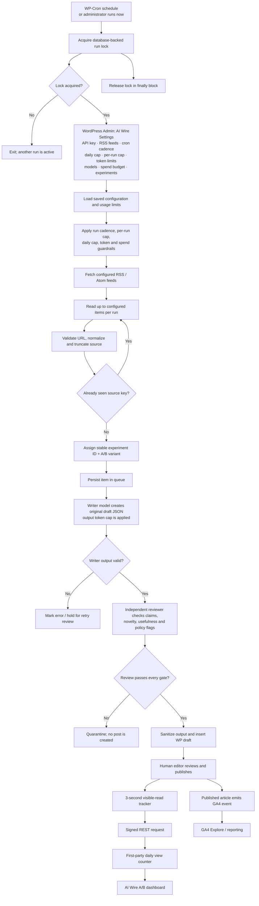
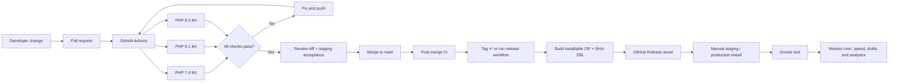

# TechnoRapper AI Wire

A WordPress plugin that turns configured RSS/Atom items into source-attributed, AI-assisted editorial drafts. Each item passes a writer and a separate editorial review. Only passing items become **WordPress drafts**; a human remains responsible for publishing.

> **Safety default:** this plugin does not auto-publish. AI review is a quality gate, not a guarantee of factual accuracy or legal clearance.

## End-to-end pipeline

The diagram below shows the normal scheduled/manual path, the editorial gate, and the reader-measurement path.



### Pipeline stages and safety boundaries

| Stage | What happens | Guardrail |
|---|---|---|
| Trigger | Hourly WP-Cron or an administrator-triggered run | A database-backed lock serializes runs |
| Ingestion | Fetch configured RSS/Atom feeds and inspect up to 10 recent items per feed | HTTP(S) URL validation, source-key deduplication, source-size cap |
| Assignment | Stable A/B assignment from the source key | Retries keep the same experiment and variant |
| Generation | Writer produces title, lede, body, category and tags | Source content is treated as untrusted input |
| Review | Separate model evaluates factual consistency, novelty, usefulness and policy flags | Fail closed: only explicit passing output proceeds |
| Draft creation | Sanitized content is inserted as a WordPress draft | No automatic publication |
| Measurement | GA4 event plus first-party 3-second visible-read counter | Signed REST payload, per-session browser dedupe, no IP storage |
| Analysis | WordPress dashboard and GA4 Explore | Do not infer revenue or SEO lift from draft counts or a small sample |

## Install and configure

1. Upload the plugin ZIP through **Plugins → Add New → Upload Plugin**, or copy the plugin directory to `wp-content/plugins/technorapper-ai-wire/`.
2. Activate **TechnoRapper AI Wire**. Activation creates/updates the queue and view tables and registers the scheduled task.
3. Open **AI Wire** in wp-admin. The complete setup is available from one dashboard screen; normal configuration does not require editing PHP or `wp-config.php`.
4. Enter your OpenAI API key in **API credentials**. The field is write-only: after saving, the key is never shown again. Leave it blank to keep the saved key, or select **Remove the saved API key** to delete it. A server constant (`OPENAI_API_KEY` or `TR_AI_WIRE_OPENAI_API_KEY`) can still be used and takes priority over the dashboard value.
5. Add RSS/Atom feeds and choose the run cadence: every 15 minutes, 30 minutes, hourly, every 6 hours or daily. Configure the maximum items per run and daily draft cap.
6. Set writer/reviewer models, maximum output tokens per AI pass, maximum source characters, monthly token ceiling, monthly USD budget, optional web search and A/B experiment settings.
7. Save all settings, then run **Fetch feeds and process queue now** once. Inspect **AI Wire → Queue & usage**, review each generated draft in WordPress, and publish manually only after editorial approval.

The API key entered in the dashboard is stored in the WordPress options database with autoload disabled. Restrict database and administrator access, use HTTPS, and prefer a server constant when your hosting environment provides a secrets manager. API usage is billed separately from ChatGPT.

#### What is configurable in the WordPress dashboard

| Dashboard section | Settings |
|---|---|
| API credentials | OpenAI API key; server constants override the saved dashboard key |
| Sources & schedule | RSS/Atom feeds, 15-minute/30-minute/hourly/6-hourly/daily cadence |
| Automation limits | Maximum feed items per run and maximum drafts per UTC day |
| AI processing | Writer/reviewer models, output-token cap per pass, source-character cap, optional web search |
| Spend guardrails | Monthly USD budget and combined monthly input/output token limit |
| Editorial experiment | Enable/disable A/B assignment and experiment ID |

The schedule is implemented with WordPress Cron. Its cadence controls when WordPress schedules a run; it does not guarantee exact wall-clock execution. On low-traffic sites, configure a hosting-level system cron to invoke `wp-cron.php`.

## Suggested initial production settings

- Start with 1–3 trusted feeds and a daily cap of 1–3 drafts.
- Set a low monthly API budget and token ceiling; raise only after observing real usage.
- Leave optional web search disabled until you have validated its cost and review output.
- Keep drafts-only workflow. Do not bypass the human editorial review.
- Use a unique experiment ID for each materially different experiment. Do not rename an experiment midway through a reporting window.

## Spend, rate and volume controls

- The daily cap counts drafts created by this plugin on the current UTC day. Set it to `0` to pause draft creation.
- The per-run item cap limits how many queued/new feed items are attempted in one scheduled or manual execution. It includes budget-held retries.
- Monthly USD and token limits use this plugin's recorded API usage and pre-request estimates. They are not provider-side hard limits and do not cap other apps using the same API project/key.
- Configure a provider-side project budget/rate limit as a second independent control.
- Cost estimates depend on the model rates configured in the source. Verify current provider pricing and update the rate table before changing model IDs or pricing.
- The optional web-search review adds search-tool and token charges.
- If the API call or review fails, the item is held in the queue; inspect errors before retrying. Budget-held items are retried by later runs when budget becomes available.

## A/B experiments and analytics

- Variant A uses the baseline writer prompt; Variant B uses the original editorial-desk prompt.
- Assignment is deterministic per source item and approximately 50/50 over a sufficiently large sample. This is **not** visitor-level randomization or topic-paired testing.
- **AI Wire → A/B experiments** reports queue outcomes for the selected experiment and first-party engaged reads from the last 30 days.
- A published experiment article emits GA4 event `tr_ai_wire_article_view` with `experiment_id`, `variant`, `article_id`, `article_title`, `page_location` and `page_title`.
- In GA4 Admin → Custom definitions, register event-scoped dimensions for `experiment_id`, `variant` and `article_id`. Use Explore to compare event counts, engaged sessions, engagement time and key events.
- First-party reads are a lightweight proxy: the browser waits 3 seconds, requires a visible page, and counts the same article once per browser session. A signed daily token protects the REST endpoint against blind unauthenticated increments; it is not bot-proof or a substitute for analytics fraud filtering.
- If browser session storage is unavailable, the first-party counter intentionally skips the read rather than risk duplicate counts.
- GA4, Search Console and AdSense reports are **not** imported into WordPress. Use GA4/AdSense reporting and Search Console for revenue, organic impressions, clicks and CTR. No revenue or SEO outcome is estimated by this plugin.
- Compare similar topics, publication age and traffic sources over several weeks. Do not select a winner from a handful of posts.

## Production deployment runbook

### Before enabling scheduled processing

- [ ] Deploy to staging first and take a database + files backup.
- [ ] Confirm the site is on a supported PHP version (7.4+) and WordPress 6.2+.
- [ ] Confirm HTTPS, valid TLS, working outbound HTTPS requests and DNS resolution to the API/feed hosts.
- [ ] Set the API key in server configuration; verify it is not present in the repository or public diagnostics.
- [ ] Configure a provider-side budget and alerts in addition to plugin limits.
- [ ] Add only trusted feed URLs. Review each feed's publisher rights, attribution requirements and content reuse terms.
- [ ] Confirm the WordPress database user can create/alter the plugin tables.
- [ ] Ensure regular database backups and a tested restore procedure.
- [ ] Configure a real system cron to invoke `wp-cron.php` if traffic-triggered WP-Cron is unreliable.

### Staging acceptance test

1. Activate the plugin and verify both `wp_<prefix>tr_ai_wire_items` and `wp_<prefix>tr_ai_wire_views` tables exist (the actual prefix depends on the site).
2. Save one test feed and run the queue manually.
3. Verify the source item is stored once, with an experiment ID and A/B variant.
4. Verify writer and reviewer outcomes are visible in the queue.
5. Confirm a passing item becomes a **draft**, not a published post; confirm a rejected item is quarantined.
6. Re-run the same feed and confirm the source key prevents duplicate queue items.
7. Test budget exhaustion and verify no further AI calls are made by the plugin.
8. Publish a test article. Verify GA4 event `tr_ai_wire_article_view` in DebugView/Realtime and a first-party count after a visible 3-second read.
9. Verify a missing/invalid view token is rejected and the valid browser fallback sends the same signed payload.
10. Deactivate and confirm scheduled plugin cron events are cleared. Reactivate and verify schema checks do not erase queue data.

### Rollout and rollback

- Roll out to a small feed set and low daily cap first. Watch queue errors, API spend, PHP logs, cron execution and draft quality for several days.
- Increase feed count/caps gradually only after validating cost and editorial quality.
- To pause processing, set the daily cap to `0` and/or remove the API key from server configuration. Deactivation clears the scheduled hook but retains queue data and drafts.
- For rollback, deactivate the plugin and restore the previous plugin package if necessary. Do not drop plugin tables unless you explicitly intend to delete queue and engagement history.
- Keep a record of the plugin version, deployed commit, active experiment ID and settings at each rollout.

## Security and privacy notes

- Admin settings and manual execution are restricted to administrators; manual execution uses a WordPress nonce.
- API credentials can be entered in the administrator-only dashboard and are stored as a non-autoloaded WordPress option; server constants override the dashboard key. Treat database backups and administrator access as secret-bearing surfaces.
- Feed/source text is untrusted model input. Generated HTML is passed through `wp_kses_post()`; titles and excerpts are sanitized.
- The public view endpoint only accepts published experiment articles with a valid daily HMAC token. The token is not sent to GA4/GTM.
- The view table stores aggregate post/day counters, not IP addresses, cookies, names or user IDs. Browser session storage is used only for per-session deduplication.
- The HMAC token is rendered into the public article page and therefore should be understood as an anti-blind-posting measure, not proof of a human reader. Use edge/WAF rate controls and analytics bot filtering if abuse becomes material.
- Keep WordPress core, PHP, the theme and other plugins patched. Use least-privilege database and hosting credentials.

## Known limitations and operational caveats

- The reviewer is an AI quality gate, not a fact-checking guarantee. Web corroboration can help but cannot certify accuracy.
- The plugin does not auto-publish, import source images, or migrate existing Feedzy jobs/posts.
- WP-Cron is traffic-triggered unless backed by a host system cron.
- Feed caching can delay discovery. Each run inspects up to 10 recent items per configured feed.
- Plugin usage limits are local estimates, not account-wide API hard limits.
- First-party engaged-read counters are approximate and can be blocked by browser privacy settings, ad blockers, JavaScript errors or session-storage restrictions.
- There is no native GA4, Search Console or AdSense data import, revenue attribution, editorial approval workflow, alerting service or remote job dashboard in this release.

## CI and release pipeline

GitHub Actions runs PHP syntax checks on PHP 7.4, 8.1 and 8.3 for pushes to `main`/feature branches and pull requests into `main`. A separate release workflow builds a WordPress-installable ZIP (with the plugin directory at the archive root), generates a SHA-256 checksum, and uploads both as a workflow artifact. Pushing a `v*` tag also publishes those files as a GitHub Release. Production deployment remains a deliberate manual action; this repository does not hold WordPress credentials.



**Important:** CI lint is only a syntax/compatibility smoke check. It does not boot WordPress, execute database migrations, mock the OpenAI API, test cron concurrency, or verify browser tracking. The staging acceptance test above is mandatory before treating a release as production-validated. A fully automated WordPress integration/browser test suite is a future hardening item.

## Development checks

Run syntax checks locally:

```bash
find . -type f -name '*.php' -print0 | xargs -0 -n1 php -l
```

The repository's GitHub Actions workflow runs the same check across the PHP matrix. To create a release, push a version tag such as `v0.2.0`; download the ZIP and checksum from the GitHub Release page, verify the checksum, then install the ZIP on staging. Keep secrets out of fixtures and logs, and test schema changes against a copy of production data before release.
