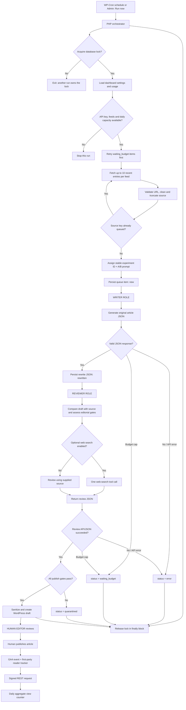

# AI Agent Workflow and Feature Audit

**Audit date:** 4 November 2026  
**Scope:** Current `main` implementation of `technorapper-ai-wire.php`, README, PHP lint workflow and release workflow.  
**Architecture note:** This is a two-role, sequential AI pipeline orchestrated by WordPress/PHP. It is not currently an autonomous multi-agent framework.

## 1. How the AI roles work

### PHP orchestrator (not an AI agent)
WordPress owns the workflow. It schedules or manually starts a run, obtains a database-backed lock, loads settings, enforces local limits, fetches RSS/Atom feeds, deduplicates source items, assigns an experiment variant, persists queue records, calls the two AI roles, and creates a WordPress draft only after the review gate passes.

### Writer role
The Writer receives the feed name, source title, source URL and truncated source text. It is instructed to treat source text as untrusted data and return JSON containing:

- Title, lede and body HTML
- Editorial angle, category and tags
- Source attribution
- Factual claims and novelty notes

Variant A uses the baseline writing prompt. Variant B uses the more detailed original-editorial-desk prompt. The variant is assigned deterministically from the source key; it is not a visitor-level experiment. Both variants use the configured Writer model.

### Reviewer role
The Reviewer receives the original source and the Writer's JSON. It checks factual claims against the supplied source, attribution, unsupported claims, usefulness, novelty, groundedness, policy flags and similarity risk. Optional web search is enabled in this call only, with at most one required search-tool call.

The plugin accepts a draft only when the review explicitly returns a passing verdict and safe-to-publish flag, all three positive pragmatism flags are true, similarity risk is not high, and fact/policy flags are empty. This is a model-generated editorial gate, not independent human fact-checking or a plagiarism detector. The Reviewer may use the same model ID as the Writer.

### Human editor
A passing item becomes a WordPress **draft**. A person must inspect, edit if necessary and publish it. There is no automatic publishing path.

## 2. Agent execution graph

## 3. Queue state and retry behavior

| State | Meaning | Current behavior |
|---|---|---|
| `new` | Source item stored; writer not completed | Eligible for processing |
| `waiting_budget` | Local monthly spend/token check blocked an AI call | Automatically retried by later runs |
| `rewritten` | Writer output stored | Not currently resumed by the run processor |
| `reviewed` | Reviewer output stored | Not currently resumed by the run processor |
| `draft` | WordPress draft created | Terminal for the pipeline |
| `quarantined` | Review gate failed or required output was missing | Not automatically retried |
| `error` | API, transport, JSON or post-creation failure | Not automatically retried |

**Important reliability gap:** `process_item()` only accepts `new` and `waiting_budget`. A transient Writer/Reviewer error is marked `error`; an interrupted run after saving `rewritten` or `reviewed` also leaves an item that future runs do not resume. There is no dashboard retry/reset action. Budget-blocked items are the only automatic retry path.

## 4. Implemented feature inventory

| Area | Implemented |
|---|---|
| WordPress admin | Central AI Wire settings page; API key, feeds, schedule, caps, model selection, web search and experiment controls |
| Credential handling | Separate write-only API-key form; non-autoloaded option; server constants supported as fallback |
| Feed ingestion | RSS/Atom feeds, HTTP(S) URL validation, up to 10 recent entries per feed per run |
| Deduplication | SHA-256 source key with a database unique key |
| Run safety | Database option lock; stale-lock recovery; lock release in `finally` |
| Workload limits | Daily draft cap and maximum items per run |
| Spend limits | Monthly local token and USD estimates; records returned API usage |
| Writer | Two prompt variants, JSON output, source attribution and editorial metadata |
| Reviewer | Separate review call, factual-grounding checks, novelty/usefulness/policy flags, optional web search |
| Draft workflow | Sanitized WordPress drafts; category/tag assignment; source and review metadata |
| Queue visibility | Latest 100 queue items, status, errors and review verdict |
| A/B reporting | Queue outcomes by variant and first-party reads over the last 30 days |
| Reader measurement | GA4/GTM event plus a first-party daily aggregate counter |
| CI/release | PHP syntax lint matrix for PHP 7.4/8.1/8.3; ZIP + SHA-256 release workflow |

## 5. Audit findings and recommended priorities

### High priority

1. **Add reliable retry/resume transitions.** Retry transient HTTP/API failures (especially 429 and 5xx) with bounded exponential backoff. Resume from `rewritten` at the Reviewer step and from `reviewed` at draft creation. Add an administrator retry action for terminal errors and a maximum-attempt count.
2. **Make the run lock a renewable lease.** The lock TTL is 45 minutes. With a configurable run cap as high as 100 and two sequential API calls per item, a run can outlive that TTL. A second run could then recover the lock while the first is still active. Add heartbeat/lease renewal and ownership checks.
3. **Make manual runs asynchronous or bounded by time.** The admin action processes the queue inside the request. At high run caps, sequential 90-second API timeouts can exceed PHP/web-server request limits. Prefer Action Scheduler or a background worker, or enforce a conservative time budget per request.
4. **Add real WordPress integration tests.** Current CI only runs `php -l`; it does not test API payloads, state transitions, schema upgrades, cron rescheduling, concurrent runs, draft creation or tracking. Add mocked Responses API tests and WordPress integration tests.

### Medium priority

5. **Improve reader tracking accuracy.** The current tracker waits three seconds, then checks visibility once; it does not accumulate three visible seconds or retry after a hidden-tab callback. Use the Page Visibility API with an accumulated visible-time timer.
6. **Protect the public view counter against replay/inflation.** The HMAC token is embedded in the public article HTML and remains valid for that post/day. Browser session storage prevents ordinary duplicate events but is client-side only; the REST endpoint has no server-side deduplication or rate limit. Add server-side throttling or signed, short-lived, one-time event tokens.
7. **Decouple GA4 emission from session storage.** If session storage throws, the current script returns before emitting the GA4 event as well as the first-party counter. GA4 event emission should not depend on first-party deduplication storage.
8. **Make A/B reporting more statistically useful.** Current reporting is aggregate engaged reads per article, not impressions, sessions, CTR or age/topic-adjusted performance. Keep it labelled as a directional proxy; add GA4/Search Console imports or exportable per-article results before declaring a winner.
9. **Add queue management.** The admin table is limited to the latest 100 items and has no filters, pagination, retry or bulk actions.

### Lower priority / operational

10. **Expose cron health.** WP-Cron is traffic-triggered. Show last-run time, next scheduled run and last failure; document/verify a real system cron for low-traffic sites.
11. **Add feed diagnostics.** Record feed fetch failures and parse errors in an admin-visible log; distinguish empty feed, invalid URL, timeout and upstream failure.
12. **Add retention controls.** Queue source text, rewrite JSON, review JSON and errors currently have no automated retention/cleanup policy.
13. **Add a model/pricing maintenance check.** Model IDs and token rates are hard-coded. Verify them against the provider catalogue and pricing before changing models. The currently configured IDs `gpt-6-luna` and `gpt-6.1-terra`, and their configured standard input/output rates, match the current OpenAI model directory; this should still be reviewed periodically.
14. **Version releases consistently.** The plugin header and internal version constant remain `0.1.0`; align them with tagged releases and any future migration.

## 6. Boundaries: what this product is not yet doing

- No autonomous agent delegation, agent-to-agent messaging or shared agent memory.
- No multi-round Writer ↔ Reviewer revision loop; the Reviewer accepts or rejects the generated draft.
- No full-article crawler or source-image import; the Writer receives RSS title and feed content/description, truncated to the configured character limit.
- No automatic publishing.
- No native import of GA4, Search Console or AdSense data into WordPress.
- No server-side guarantee that a first-party tracked read represents a human visitor.

## 7. Overall assessment

The current implementation is a useful controlled editorial automation: feed ingestion → Writer → Reviewer → human-approved WordPress draft, with local usage limits and basic experiment measurement.

Its strongest safeguards are source attribution, duplicate prevention, budget holds, a separate review call, fail-closed review conditions and drafts-only publishing. The most important engineering gaps are retry/resume handling, long-running job execution/lock renewal, and automated integration coverage. Reader analytics are useful for directional monitoring but should not be treated as fraud-resistant or statistically conclusive.
