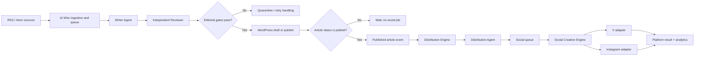

# AI Wire Social Distribution Architecture

**Status:** Architecture and rollout reference for the opt-in social distribution feature. A first implementation is present on the social distribution branch ([PR #39](https://github.com/HaneetGH/technorapper-ai-wire/pull/39)); production validation and a live canary remain separate gates.  
**Date:** 8 November 2026  
**Scope:** Post-publication distribution to X and Instagram.  
**Core boundary:** AI Wire owns editorial content and TechnoRapper article publishing. The Distribution Engine owns social copy, social assets and platform delivery. AI-generated images are only for social media; they are never required or generated for a TechnoRapper article.

## Purpose and design principles

AI Wire already performs the editorial work: it ingests RSS/Atom items, creates article content and metadata with a Writer, reviews it independently, and creates a WordPress draft or publishes it according to the configured publish setting. The social system should reuse the result of that work instead of generating a second article or repeating editorial research.

The proposed flow is:



The separation is intentional:

- **AI Wire is the editorial system.** Its Writer and Reviewer remain responsible for the article, its factual grounding, SEO fields and editorial gates.
- **The Distribution Engine is a downstream consumer.** It only receives an article after WordPress confirms it is published. A draft, rejected item or failed article publication creates no social post.
- **The Distribution Agent repackages.** It creates platform-specific copy and creative instructions from approved article fields. It does not write or alter the article.
- **The Social Creative Engine creates social assets.** It can select an allowed source image, render a branded template, or generate an optional AI image for social destinations only.
- **Platform adapters deliver independently.** An X failure must not prevent an Instagram post, or vice versa.

## System responsibilities

### AI Wire (existing)

AI Wire remains responsible for feed ingestion, source deduplication, editorial queueing, Writer and Reviewer calls, review gates, WordPress post creation, and its existing article measurement. The current Writer output includes fields useful to distribution, such as `title`, `lede`, `category`, `tags`, `social_title`, `social_description`, `featured_image_alt`, `key_takeaways`, `faq`, `official_links` and `internal_links`.

The post's featured image remains governed by the article pipeline's existing source-image behavior. Adding this social system must not add an image-generation requirement to that pipeline, make article publication wait for social image generation, or place a social-generated asset in the article's featured-image field.

### Distribution Engine (proposed)

The Distribution Engine listens for a published-post event or performs a reliable scan for newly published eligible posts. It creates one distribution record per article and one delivery record per destination. It owns social-specific state, usage limits, retries, adapter calls and reporting. It should be implemented as a separate plugin module/service boundary, even if it initially runs in the same WordPress plugin and database.

### Distribution Agent (proposed)

The Distribution Agent receives a bounded snapshot of the published article and generates validated structured output. Its job is to select a useful angle already supported by the article and adapt that framing to each platform. It must not introduce claims, dates, quotes, statistics or promises that are not supported by the supplied fields. It must preserve names, product/model names and links accurately and avoid presenting an unverified claim as confirmed.

Suggested input:

```json
{
  "post_id": 123,
  "article_url": "https://technorapper.com/example/",
  "published_at": "2026-11-08T10:30:00Z",
  "title": "Published article title",
  "lede": "Article summary",
  "category": "AI",
  "tags": ["AI", "Technology"],
  "social_title": "Optional approved social title",
  "social_description": "Optional approved summary",
  "key_takeaways": ["Supported takeaway one", "Supported takeaway two"],
  "featured_image_alt": "Description of the article's source image",
  "source_image_url": "https://publisher.example/image.jpg"
}
```

Suggested output (the exact limits must be checked against each platform at implementation time):

```json
{
  "priority": "normal",
  "x": {
    "text": "Platform-ready post copy with article URL",
    "asset_brief": "Optional landscape crop or no asset"
  },
  "instagram": {
    "caption": "Platform-ready caption with a clear article call to action",
    "headline": "Short on-image headline",
    "subheadline": "Optional supporting line",
    "hashtags": ["Technology"],
    "visual_type": "source_image|branded_card|ai_image",
    "asset_brief": "Instructions for a social-only visual"
  }
}
```

Output validation checks schema, allowed priority/visual type, link correctness, text limits, forbidden unsupported claims and required fields before enqueueing. Invalid output is retried under the normal bounded retry policy or held for review; it is never sent directly to an adapter.

## End-to-end data flow

1. **Editorial processing:** AI Wire discovers and deduplicates a source, then runs Writer → Reviewer and applies its existing gates.
2. **Article creation:** A passing item becomes a WordPress draft or published post according to current AI Wire settings. Social work only starts after WordPress confirms `post_status=publish`; a later transition from draft to publish should trigger the same event.
3. **Publication event:** The Distribution Engine records the WordPress post ID, canonical URL, publication timestamp and an immutable content snapshot/version. It inserts one distribution job using a uniqueness key based on post ID and distribution version.
4. **Copy generation:** The Distribution Agent receives only approved article fields needed for distribution. It produces separate X and Instagram copy/creative briefs. It does not receive credentials and cannot call platform APIs.
5. **Creative selection:** The Social Creative Engine resolves an asset independently for each platform according to the asset policy below. It stores social assets separately from article media fields.
6. **Queueing:** A destination delivery is queued only when that platform is enabled, its copy passes validation and required creative is ready. Each destination has an independent state machine.
7. **Publishing:** The X and Instagram adapters upload/post using the appropriate API and credentials. A successful response records platform post/media IDs and timestamps. An ambiguous timeout is reconciled before another create request is issued.
8. **Measurement:** Delivery outcomes and supported platform metrics are stored against the distribution and delivery records. Article analytics remain distinct from social impressions, engagement and referral traffic.

## Social queue and data model

Use dedicated tables or equivalent durable records; do not overload the existing AI Wire editorial item row. Names below are conceptual and may be adapted to the plugin's schema conventions.

### `tr_ai_wire_distributions` (one per article/version)

| Field | Purpose |
|---|---|
| `id` | Internal primary key |
| `post_id` | WordPress article ID |
| `distribution_version` | Explicit version for intentional regeneration after material edits |
| `article_url` | Canonical published URL snapshot |
| `article_snapshot` | Bounded, sanitized article fields used for copy generation |
| `content_hash` | Detects whether relevant article content changed |
| `status` | `queued`, `generating`, `ready`, `partial`, `complete`, `held`, `cancelled`, `error` |
| `priority` | `normal`, `important`, `breaking`; optional scheduling priority, not an override of review requirements |
| `created_at`, `updated_at`, `completed_at` | Lifecycle timestamps |
| `last_error_code` | Safe, actionable error classification; never store secrets |

Unique constraint: `(post_id, distribution_version)`. A change to an already published article must not silently create duplicate social posts. An administrator can explicitly create a new version or edit queued content before delivery.

### `tr_ai_wire_social_deliveries` (one per destination)

| Field | Purpose |
|---|---|
| `id`, `distribution_id` | Identity and parent relationship |
| `platform` | `x` or `instagram` |
| `state` | `pending`, `generating_asset`, `ready`, `publishing`, `published`, `retry_wait`, `held`, `failed`, `cancelled` |
| `copy_json` | Validated, platform-specific copy |
| `asset_id` | Reference to a social asset, if required |
| `idempotency_key` | Stable key for this delivery attempt family |
| `attempt_count`, `next_attempt_at` | Bounded retry scheduling |
| `platform_media_id`, `platform_post_id`, `platform_url` | Reconciliation and reporting |
| `published_at`, `last_attempt_at` | Delivery timestamps |
| `last_error_code`, `last_error_at` | Safe failure details |

Unique constraint: `(distribution_id, platform)`. A platform can be retried or held without changing another platform's state.

### `tr_ai_wire_social_assets` (optional asset ledger)

Store `id`, parent delivery/distribution, asset type (`source`, `template`, `ai_generated`), storage reference, MIME type, dimensions, prompt/template version, model/provider, estimated cost, actual cost when available, creation time and rights/provenance notes. Keep asset objects in WordPress media or object storage with private/internal metadata; keep the asset reference out of the article's featured-image metadata unless an editor separately chooses an image under the editorial workflow.

Retention should be configurable and documented. Keep platform IDs and delivery outcomes for reconciliation; expire large intermediate files and prompt/request payloads according to an explicit retention policy.

## X and Instagram adapters

The adapters should implement a common interface such as `validate()`, `prepare_media()`, `publish()`, `lookup()`/`reconcile()` and `fetch_metrics()`. They own platform authentication, payload formatting, media upload and API-specific error classification. Keep platform credentials server-side and separate per account/environment. Never pass credentials into the Distribution Agent or store them in queue payloads/logs.

### X adapter

- Primary output is concise text with the canonical article URL. The Agent should leave headroom for URL length accounting and platform limits.
- An image is optional and selected/generated as a social asset only. A distinct crop or card can be used; do not assume the Instagram file is the right X asset.
- Record the returned post ID and URL. Handle access tier, rate-limit and API capability differences as configuration/runtime facts rather than hard-coded assumptions.

### Instagram adapter

- Prepare a platform-compliant image or carousel using current API requirements. The caption is separate from any on-image headline.
- An article link is included as a clear call to action; use the configured profile/link strategy where captions do not create clickable links.
- Record container/media and published post IDs and the returned permalink when available. Respect account type, publishing permissions, media processing status and API quotas.

Platform requirements, pricing/access tiers and supported media formats can change. Verify current official platform documentation during implementation and keep adapter-specific limits configurable.

## Social Creative Engine and image rules

The Social Creative Engine chooses among these options per destination:

1. **Source image:** Reuse an article/source image only when rights and attribution permit social reuse and the image meets platform dimensions and quality needs. Preserve attribution where required. Do not treat the availability of an image URL as proof of usage rights.
2. **Branded template:** Render a TechnoRapper card with headline, small supporting text, category/brand elements and an article URL or call to action. This should be the predictable, low-cost default when no safe source visual fits.
3. **AI-generated social image:** Optional fallback or deliberate creative choice, controlled by configuration, budget and editorial rules. Generate illustrative graphics rather than fabricated documentary-looking depictions of real events or people. Store provenance and prompt/model metadata. Review moderation, trademark, likeness and factual implications.

**Hard invariant:** AI image generation is only invoked from the Social Creative Engine for an enabled social delivery (currently X or Instagram, when configured). It is never invoked by the AI Wire Writer, Reviewer, article publisher or WordPress featured-image flow. A TechnoRapper article does not depend on an AI-generated image to be drafted, reviewed or published. A social asset failure falls back to an allowed source image or branded template, or holds/skips that destination; it never blocks or changes the article.

The plugin should enforce this in code boundaries and configuration: distinct social image setting/budget, distinct social asset storage/reference, no write into the article's featured-image field, and tests/monitoring that assert article jobs cannot invoke the image provider. A social asset may be stored in WordPress Media and referenced from social-specific post metadata; it must remain separate from the article's featured-image metadata. The distribution UI should label generated files as social assets.

## Cost-control strategy

Text distribution should reuse existing editorial output and make at most one small copy-generation pass per published article (or one request producing both platform variants). Do not run a second research or article-writing pipeline. Template rendering has no image-provider charge; source reuse also avoids generation charges.

AI image generation is optional and must have its own controls, separate from AI Wire's existing monthly text/token budgets:

- Enable/disable AI-generated social images globally and per destination.
- Default to source/template; require explicit policy/configuration before AI generation.
- Set daily/monthly image spend and count caps, per-image quality/size ceiling, and maximum attempts.
- Estimate before a request; reserve budget atomically; reconcile estimate with actual usage when known. Stop new image calls when the cap is reached.
- Include prompt tokens, retries, moderation/refusals and regeneration in cost accounting. Use a provider-side budget/rate limit as a second control.
- Record model, output size/quality, request outcome and estimated/actual cost per asset.
- Never retry a refusal or deterministic invalid prompt indefinitely. Reduce size/quality only under an explicit fallback policy.
- Do not reuse stale image-price figures as configuration. Verify current provider rates when implementing and keep a rate table/version date.

For planning, compute monthly spend as: `published articles × eligible social destinations × generation rate × average cost per generation × (1 + retry/refusal allowance)`, plus copy generation and infrastructure. Use measured pilot usage, not a single assumed image-per-article rate. The [image generation cost estimate](IMAGE-GENERATION-COST.md) budgets this social-only path (GPT Image 2 low portrait in the first implementation). Article featured images stay on RSS URLs and are not part of that bill.

## Idempotency, retries and failure isolation

- **Event deduplication:** Unique `(post_id, distribution_version)` prevents duplicate jobs when WordPress hooks fire more than once or a scanner rediscovers the same post.
- **Destination deduplication:** Unique `(distribution_id, platform)` ensures only one delivery record per platform/version.
- **Stable delivery key:** Derive a stable key from distribution ID, destination and content version. Use provider idempotency support when available.
- **Ambiguous publish result:** If a timeout occurs after a request may have succeeded, mark it `reconcile_pending`; lookup by stored provider response/request metadata or inspect recent posts before retrying. Do not blindly repeat a non-idempotent publish call.
- **Retry only transient errors:** Network failures, 429 and transient 5xx errors receive bounded exponential backoff with jitter and respect provider retry-after values. Invalid credentials, unsupported media, invalid payloads and policy errors become actionable held/failed states.
- **Per-platform isolation:** X and Instagram have independent attempts, credentials, quotas and state. One may complete while the other waits or fails.
- **Asset isolation:** A generation failure does not poison the other platform's asset job. Try configured source/template fallbacks before holding a destination.
- **Operator controls:** Provide retry, hold, cancel and safe regeneration actions with clear audit history. Editing copy after a completed publish requires an explicit new distribution version; never silently overwrite a published platform post.
- **Queue worker:** Use bounded background jobs, leases/locks and stale-job recovery consistent with the existing AI Wire approach. Avoid long-running work in an admin page request. Respect host cron reliability and surface last-run/next-run health.

## Analytics and reporting

Keep three measurements distinct:

1. **Article analytics:** Existing WordPress/GA4 and first-party article read tracking.
2. **Social delivery:** queued, generated, published, held, failed, retry count, latency, destination and API cost.
3. **Social performance:** platform-reported impressions/reach, likes, replies/comments, shares, saves and link clicks where available, plus article referral sessions in GA4.

Attach campaign/source/medium values to social links (for example `utm_source`, `utm_medium=social`, `utm_campaign` and a post/destination content key) while preserving the canonical article. Avoid putting personal data in URLs. Store metric snapshots with retrieval timestamps because platforms may revise metrics and retention/access can differ.

The dashboard should compare posts by destination and time window, and show missing/unsupported metrics explicitly. Platform engagement is not equivalent to unique people, article readership, revenue or causal lift. Use GA4 and platform reporting for their respective signals; do not merge them into AI Wire's editorial quality score.

## Rollout plan

### Phase 0 — design and credentials

- Confirm account ownership, platform API access/tiers, account types, required permissions and current publishing/media constraints.
- Define source-image rights policy, brand templates, AI-image policy, retention, UTM format and editorial escalation rules.
- Choose whether to add a module to AI Wire or a separately deployed Distribution Engine; keep the storage and invocation boundaries described above in either case.

### Phase 1 — dry-run distribution

- Create jobs only for newly published posts, generate copy and render templates, but do not call social publish APIs.
- Show copy/assets in a review queue. Validate formatting, article links, attribution, image crops, costs and deduplication.
- Keep AI image generation off; measure text and template behavior first.

### Phase 2 — controlled publishing

- Enable one destination at a time, with low daily caps and explicit human approval before publishing.
- Start with source images when rights are clear, otherwise branded templates. Monitor queue health and platform feedback.
- Test duplicate WordPress events, article edits, rate limits, timeouts, ambiguous publish results, expired credentials and retries.

### Phase 3 — limited automation

- After a stable canary, enable automatic publishing for selected categories or posts while retaining a hold/review path for breaking, sensitive or low-confidence items.
- Keep AI-generated social imagery disabled initially. If enabled later, pilot a low-cost format under a separate cap and compare asset quality, refusal/retry rate and engagement.
- Increase volume gradually based on measured success rates, provider limits, API costs and human review load.

### Rollback

Disable the affected destination or the Distribution Engine without changing AI Wire's article pipeline. Stop new social jobs, allow in-flight requests to reconcile, and retain delivery history. Do not delete queue/history tables as a rollback step. Published articles and their media remain unchanged.

## Observability and acceptance criteria

Before production automation, verify that:

- A draft, rejected article and failed editorial job never create social delivery jobs.
- Publishing (including draft-to-publish transition) creates one distribution/version and at most one delivery per enabled destination.
- Social-generation code cannot write an AI-generated file to a TechnoRapper post's featured-image field and cannot be invoked by article drafting/publishing.
- X and Instagram can succeed/fail/retry independently.
- An ambiguous platform timeout does not produce a duplicate post on retry.
- Daily/monthly social spend limits prevent new image requests once exhausted.
- Credentials are not exposed in generated prompts, logs, queue payloads or browser responses.
- Editors can inspect, hold, retry and cancel jobs, and operators can see last-run, next-run and actionable errors.
- A small canary has acceptable delivery success, asset quality, costs and analytics attribution before caps are raised.

## Current implementation and boundary

The current feature branch adds an opt-in post-publication path in `includes/class-social.php`, integrated with the existing WordPress plugin. Its first version:

- Defaults social distribution off; only eligible AI Wire-created posts published while enabled are queued, and configured destinations require saved credentials.
- Stores one independent queue row per `(post_id, platform)` in the social table. A worker processes a bounded row under a lock; the daily cap counts unique articles, allowing another configured platform for an article already counted that day.
- Generates one GPT Image 2 low portrait social image, overlays a TechnoRapper title card locally with GD using one of five per-article layout variants (plus a rotating camera prompt), stores it in WordPress Media, and reuses the same attachment across configured destinations. The image is referenced by social-specific metadata and never becomes the article's featured image. Existing live posters stay on `poster-v2` until regenerated.
- Publishes to X and Instagram through separate platform workflows and records destination outcomes. Ambiguous publish outcomes require manual review before retry; they are not blindly repeated.
- Uses a local monthly social-image estimate/budget, separate from Writer/Reviewer text spend. It is an application-side estimate, not a provider-enforced hard cap. X access/usage charges are separate.

The richer options in this architecture—such as choosing a rights-cleared source image, using a template without AI generation, and different per-platform creative—are design choices for future iterations, not descriptions of the first implementation. In the current version, image generation is part of the social delivery path when enabled; if its budget is zero or exhausted, the social image and delivery are held/skipped according to the implementation policy. This still does not affect article drafting, review, publication or featured images.

For implementation decisions, current behavior, API/hosting constraints and the staging checklist, see the companion [Social Distribution Implementation Handoff](https://github.com/HaneetGH/technorapper-ai-wire/blob/codex/opt-in-social-distribution/docs/SOCIAL-DISTRIBUTION-HANDOFF.md) on [PR #39](https://github.com/HaneetGH/technorapper-ai-wire/pull/39). For the editorial workflow and code-level audit, see [AI Agent Workflow and Feature Audit](AI-AGENT-WORKFLOW-AUDIT.md); for image cost assumptions, see [Image generation cost estimate](IMAGE-GENERATION-COST.md).
