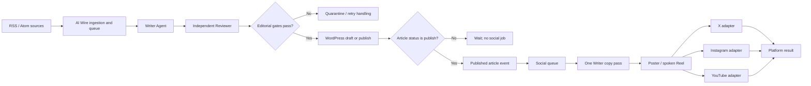
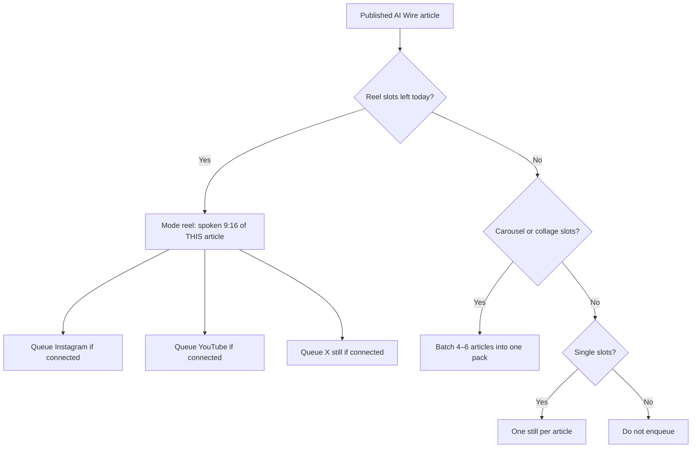

# AI Wire Social Distribution Architecture

**Status:** Shipped in plugin **0.2.54** (schema v9). Production validation and a live canary remain separate gates for each operator.  
**Date:** 10 November 2026  
**Scope:** Post-publication distribution to **X**, **Instagram** (stills, carousel, collage, spoken Reel), and **YouTube Shorts** on any WordPress site that installs the plugin.  
**Core boundary:** AI Wire owns editorial content and WordPress article publishing. Social distribution owns copy, social assets, and platform delivery. AI-generated images and Fal motion clips are only for social destinations; they are never required for the WordPress article.

Merged threads this document now describes: social news formats (PR #63), spoken Instagram Reels (PR #64), YouTube Shorts with API metadata and Google sign-in (PR #65).

## Purpose and design principles

AI Wire already performs the editorial work: it ingests RSS/Atom items, creates article content and metadata with a Writer, reviews it independently, and creates a WordPress draft or publishes it according to the configured publish setting. The social system reuses that result. It does not write a second article or repeat editorial research.

The separation is intentional:

- **AI Wire is the editorial system.** Writer and Reviewer remain responsible for the article, its factual grounding, SEO fields and editorial gates.
- **Social distribution is a downstream consumer.** It only runs after WordPress confirms `post_status=publish`. A draft, rejected item or failed article publication creates no social post.
- **One copy pass repackages.** The current Writer model writes hook, on-image lines, X/Instagram captions, a spoken Reel script, and YouTube title/description/tags from approved article fields. It does not alter the article.
- **Creative is social-only.** GPT Image 2 low posters, Fal motion, Mini TTS and ffmpeg mux exist for X / Instagram / YouTube Shorts. They never become the article featured image.
- **Platform adapters deliver independently.** An X, Instagram, or YouTube failure must not prevent the other destinations.

## What is shipped

| Concern | Current behavior |
|---|---|
| Master switch | `social_distribution_enabled` default **0**. Each network also has its own toggle. |
| Destinations | `x`, `instagram`, `youtube` — only when credentials exist **and** that network is on. YouTube-only installs do not force X or Instagram on. |
| Queue | One row per `(post_id, platform)` in `{prefix}tr_ai_wire_social`. Unique key prevents duplicate destinations. |
| Daily cap | Unique **articles** (1–10), not per-network posts. A successful Instagram or YouTube post does not spend an extra X slot for the same article. |
| Mix | Operators set daily counts for **Reel**, **carousel**, **collage**, and **single-story**. Reel fills first (default **0** / off), then carousel, then collage, then singles. |
| YouTube eligibility | YouTube rows are created **only** for `reel` mode. Stills, carousels and collages never go to YouTube. |
| Policy | Local profanity/slur list plus OpenAI Moderation on article text and on outbound social copy (captions, Reel script, YouTube title/description/tags, on-image lines). A hit holds the job; it does not post. |
| Credentials | Non-autoloaded option. X = four Keys and tokens (OAuth 1.0a). Instagram = Page token + Professional account ID (optional Meta Unified Login). YouTube = Google OAuth client + **Sign in with Google** (or a pasted refresh token). A YouTube/Google **API key cannot upload**. |

## End-to-end data flow

1. **Editorial processing:** AI Wire discovers and deduplicates a source, then runs Writer → Reviewer and applies its existing gates.
2. **Article creation:** A passing item becomes a WordPress draft or published post. Social work starts only after WordPress confirms `publish`, including a later draft-to-publish transition.
3. **Queue insert:** For each connected, enabled platform, insert one `queued` row. YouTube is skipped unless the article’s social mode is `reel`.
4. **Copy generation:** One Writer JSON pass. Invalid or policy-failing copy is held; it is never sent to an adapter.
5. **Still graphic:** GPT Image 2 low 1080×1350, GD overlay of this site’s name, cached as `_tr_ai_wire_social_image_id`. Reused across platforms. X always gets this still (even when Instagram/YouTube get a Reel).
6. **Spoken Reel (when mix allots a Reel):** Fal image-to-video (suggested Veo 3.1 Lite), Mini TTS (`gpt-4o-mini-tts` / `cedar`), ffmpeg mux with captions and a brand sting. Missing Fal key or `ffmpeg` **holds** the job — no slideshow fallback.
7. **Publish:** X, Instagram and YouTube adapters run separately. Ambiguous timeouts go to `needs_review`; they are not blindly retried.
8. **YouTube listing:** `videos.insert` sets title, description (`#Shorts` + tags + permalink), tags, category, language, license, **public** privacy, not-made-for-kids, and synthetic-media disclosure in that call. `publishAt` is never set. If the channel default is private, the worker updates the video to public.

## Social queue data model (as implemented)

The plugin does **not** ship separate `tr_ai_wire_distributions` / `tr_ai_wire_social_deliveries` tables. Those names were an earlier design sketch. Schema v9 uses one destination table:

### `{prefix}tr_ai_wire_social` (one row per article × platform)

| Field | Purpose |
|---|---|
| `id` | Primary key |
| `post_id` | WordPress article ID |
| `platform` | `x`, `instagram`, or `youtube` |
| `status` | `queued`, `processing`, `published`, `needs_review` |
| `attempts` | Claim/retry counter |
| `image_attachment_id` | Cached still (and, for Reels, the spoken MP4 lives in post meta / Media) |
| `copy_json` | Validated social copy snapshot |
| `remote_id`, `remote_url` | Platform media/post ID and permalink (YouTube video ID while processing) |
| `error_text` | Safe operator-facing error; never secrets |
| `created_at`, `updated_at` | Lifecycle timestamps |

Unique constraint: `(post_id, platform)`.

Related post meta (not a second table): `_tr_ai_wire_social_mode` (`reel` / `single` / `pack` / `collage`), `_tr_ai_wire_social_image_id`, `_tr_ai_wire_social_copy`, Reel attachment IDs, YouTube pending video ID on `remote_id` during processing wait.

A richer parent-distribution + per-delivery ledger remains a possible future split; it is not required for the current worker.

## Mix and formats

- **Reel:** one spoken story, 15–18s voiceover on ~8s Fal motion plus hold-last-frame. Default daily limit **0** (off). Operator turns it on by raising Reels per day.
- **Carousel:** swipeable Instagram post (cover + stories + curiosity slide). X attaches up to 4 images in one tweet.
- **Collage:** one packed graphic of several posters.
- **Single:** one article, one still.

News graphic **types** (editorial poster, photo brief, breaking kicker, rumor card, device mockup, weekly recap cover, numbered list, and the rest listed on Social settings) are selectable format families. They are not example headlines copied from other accounts.

## Platform adapters

Adapters own authentication, payload formatting, media upload and error classification. Credentials stay in the non-autoloaded option. They never go into Writer prompts, queue JSON, or logs.

### X

- OAuth 1.0a Keys and tokens (Read and Write). Bearer is optional and not required.
- Uploads the branded still; carousel = one tweet with up to 4 images.
- Spends **X developer credits**. Queue `credits depleted` is X billing, not OpenAI.

### Instagram

- Professional account + Page token (or Meta Unified Login).
- Meta **fetches** a public WordPress Media URL (JPEG or Reel MP4). `media_type=REELS` for spoken video.
- Rolling 24-hour publishing quota; full quota **defers** (stays `queued`). Not `credits depleted`.
- Caption URLs are not clickable.

### YouTube

- Google Cloud OAuth client (YouTube Data API v3). **Sign in with Google** (`youtube.upload` + `youtube.readonly`) stores a refresh token. A pasted refresh token is the advanced fallback. An API key cannot upload.
- Worker **uploads MP4 bytes**. Google does not fetch a Media URL. Same spoken file as the Instagram Reel.
- Listing is API-only and **public immediately**: `snippet.title`, `description`, `tags`, `categoryId`, `defaultLanguage`, `status.privacyStatus=public`, `selfDeclaredMadeForKids=false`, `containsSyntheticMedia=true`, `license=youtube`. No Studio draft, no `publishAt`.
- No Google per-upload fee. Default **100 `videos.insert`/day**. Quota leaves the item queued. After a successful PUT, processing wait stores `remote_id` and polls instead of uploading again.
- If channel default privacy is private, `videos.update` forces public.

## Social Creative Engine

1. **GPT Image 2 low poster** (default): 1080×1350, hashed layout variant, site-name overlay. Required for X stills and as the Reel still that Fal animates.
2. **Spoken Reel:** Fal catalog on Social settings (Veo 3.1 Lite suggested at ~$0.24 / 8s; Veo Fast, Veo 3.1, Kling 3.0 Standard/Pro). **$10/month** video budget. Price estimate page compares them.
3. **No slideshow fallback.** Missing ffmpeg, Fal key, or video budget holds the Reel/YouTube job.

**Hard invariant:** Image and video generation are only invoked from the social worker for an enabled destination. They are never invoked by the article Writer, Reviewer, publisher or featured-image flow. A social failure never blocks or changes the WordPress article.

## Cost-control strategy

Meters are not interchangeable. See [What it costs to run](PLATFORM-COSTS.md).

| Meter | Who bills it | Plugin control |
|---|---|---|
| OpenAI text | OpenAI | Writer/Reviewer monthly budget (copy + Reel script tokens) |
| Social stills + Mini TTS | OpenAI | Social image budget (default $5) |
| Fal motion | Fal.ai | Social video budget (default $10) |
| X API credits | X | Queue error `credits depleted` |
| Instagram quota | Meta (no per-post fee) | Defer / stay queued |
| YouTube Data API quota | Google (no per-upload fee) | Defer / stay queued |

Text distribution uses at most one copy-generation pass per published article. Do not run a second research pipeline.

## Idempotency, retries and failure isolation

- Unique `(post_id, platform)` prevents duplicate destinations when hooks fire twice.
- Worker claims a row atomically (`queued` → `processing`).
- Instagram quota, Fal/YouTube processing wait, and YouTube quota return the row to `queued` with a later cron tick.
- Ambiguous publish responses go to `needs_review`. **Post existing graphic** retries without spending image budget. **Generate a new graphic and retry** is explicit. **Regenerate graphic and post again** deletes the live X/Instagram/YouTube post first; if delete fails, the original stays up.
- Connecting a network later backfills missing rows: stills for X/Instagram, spoken Shorts only for YouTube reel-mode articles.
- Per-platform isolation: Instagram can fail while YouTube and X still publish.

## Analytics and reporting

Keep three measurements distinct:

1. **Article analytics:** WordPress/GA4 and first-party article reads.
2. **Social delivery:** queued, published, needs_review, retry, destination, local cost estimates.
3. **Social performance:** platform-reported metrics and referral sessions — not merged into the editorial quality score.

## Observability and acceptance

Before production automation, verify that:

- A draft, rejected article and failed editorial job never create social rows.
- Publish (including draft-to-publish) creates at most one row per enabled destination.
- YouTube rows appear only for Reel-mode articles.
- Social generation cannot write into the article featured-image field.
- X, Instagram and YouTube can succeed/fail/retry independently.
- An ambiguous platform timeout does not duplicate a post.
- Image and video budgets stop new provider calls once exhausted.
- Credentials are not exposed in prompts, logs, queue payloads or the settings form.
- Google sign-in (not an API key) is how YouTube uploads authenticate.
- Editors can inspect, hold, retry and cancel jobs.

## Rollout

Disable a destination or all social distribution without changing the article pipeline. Stop new jobs, let in-flight requests reconcile, retain queue history. Do not drop `{prefix}tr_ai_wire_social` as a rollback step.

Operator runbook, API constraints and staging checklist: [Social Distribution Implementation Notes](SOCIAL-DISTRIBUTION-HANDOFF.md). Editorial pipeline: [AI Agent Workflow and Feature Audit](AI-AGENT-WORKFLOW-AUDIT.md). Billing: [What it costs to run](PLATFORM-COSTS.md). YouTube/Google sign-in is configured on **Social settings**; Instagram Meta app steps stay in [Instagram Content Publishing Setup](INSTAGRAM-CONTENT-PUBLISHING-SETUP.md).
