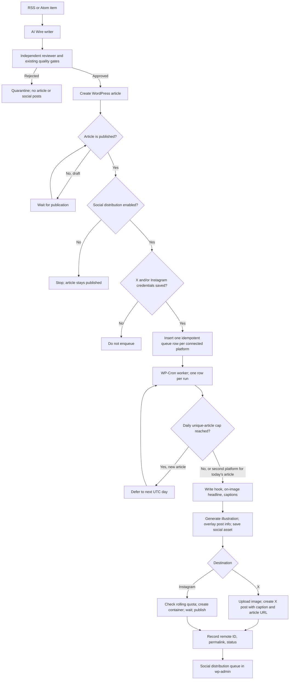
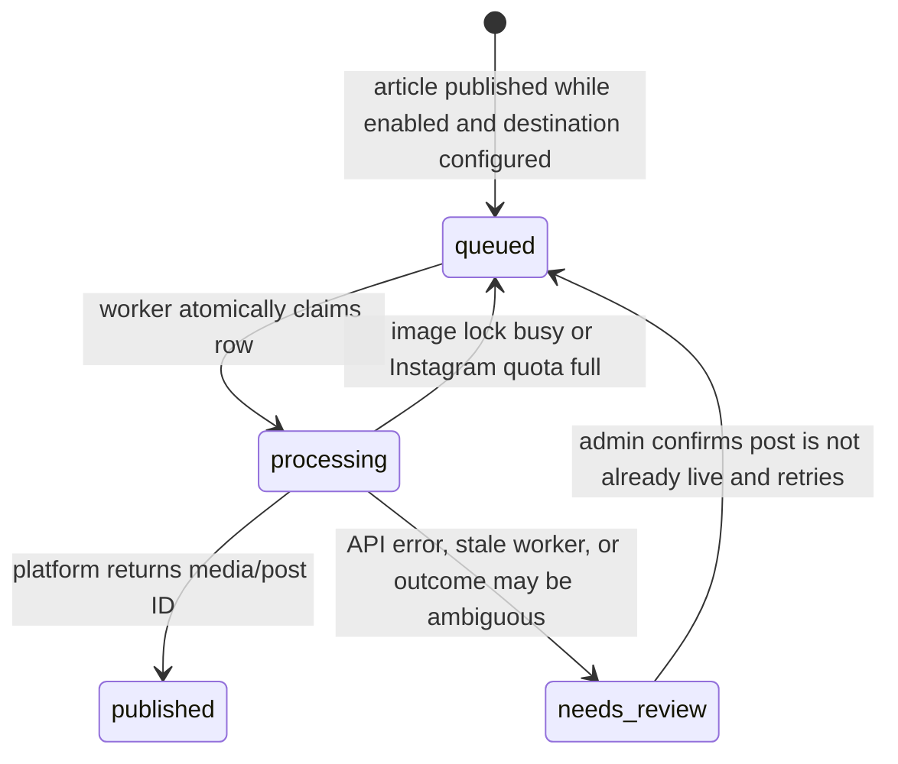

# Social Distribution: Implementation Handoff

**Updated:** 8 November 2026
**Repository:** [HaneetGH/technorapper-ai-wire](https://github.com/HaneetGH/technorapper-ai-wire)
**Active PR:** this branch — social creative pipeline (hook graphic + captions + X/Instagram). See also [#39](https://github.com/HaneetGH/technorapper-ai-wire/pull/39).

## Flow diagrams

### Article to social posts



### Switch and credential lifecycle

```mermaid
flowchart LR
    A[Default: switch off] --> B[Admin saves platform token(s)]
    B --> C[Admin enables Social distribution]
    C --> D[Future AI Wire articles published]
    D --> E[Queue only configured destinations]
    E --> F[Worker posts; history remains in WordPress]
    C -->|Admin turns switch off| G[Pause queued delivery]
    G -->|Admin turns switch on| E
    H[Token expires / API error / ambiguous response] --> I[needs_review]
    I --> J[Admin checks platform and confirms it is not already posted]
    J -->|Confirmed| E
```

### Queue states



## Objective and agreed behavior

Build an opt-in distribution feature for up to **10 unique AI Wire articles per UTC day** on X and Instagram. Use one branded image per article and reuse it on every configured destination. The existing article writer and independent reviewer remain the editorial source of truth; do not add a second article-writing agent or regenerate article copy for social.

- The main **Social distribution** switch defaults to off. Off means no new social queue work; it does not unpublish or alter existing WordPress articles.
- Enabling the switch queues a site-context job **only after** X and/or Instagram credentials are saved. With no social account connected, that job does not run and no OpenAI tokens are spent on context, captions, or social images. When onboarded, the job uses the same Writer model to read this WordPress site (name, tagline, desks, about page, recent stories) and stores a profile later social copy/graphics must follow. The dashboard shows “We are understanding you” while that job runs, the last understood time, and whether a refresh is due (14 days, or if the site identity fingerprint changed).
- Credentials are configured before enabling. Only destinations with complete credentials receive a queue row.
- Only AI Wire-created WordPress `post` articles are eligible. Their `_tr_ai_wire_queue_id` post meta is the source marker.
- Only articles that publish after the switch is enabled are queued. Drafts can be queued if they are later published while the switch is on. Do not backfill old posts in this first version.
- Turning the switch off pauses pending delivery. Turning it on resumes pending rows.
- Daily limit is **unique articles**, so an article's X and Instagram rows both count as one article. The setting is clamped to 1–10.
- One social copy package (hook, on-image headline, captions) is generated from the published article, then one branded graphic with that post info on the image. The graphic is cached and reused across both networks. If the image budget is zero or exhausted, do not generate a social image or publish a post without the branded graphic.
- Do not automatically repeat a platform publish when the response is ambiguous. Mark it for review; require an administrator to confirm the post is not already live before retrying.

## Repository context

AI Wire is a WordPress plugin. RSS ingestion, writing, independent review, SEO preparation, and WordPress publishing already exist. The distribution feature starts **after** the existing publisher has made the article live.

Read these files first:

1. [`README.md`](../README.md): current plugin configuration, publishing architecture, production runbook, and social feature description.
2. [`docs/AI-AGENT-WORKFLOW-AUDIT.md`](AI-AGENT-WORKFLOW-AUDIT.md): writer/reviewer pipeline and publishing behavior.
3. [`docs/IMAGE-GENERATION-COST.md`](IMAGE-GENERATION-COST.md): article image versus social image, current local estimate, and budget assumptions.
4. `includes/class-publisher.php`: AI Wire article creation and `_tr_ai_wire_queue_id` metadata.
5. `includes/class-admin.php`, `includes/class-settings.php`, `includes/class-schema.php`, and `includes/class-plugin.php`: dashboard, settings sanitization, schema upgrade, and hooks.
6. `includes/class-social.php`: credentials, queue worker, social copy, branded graphic, X and Instagram publishing, retries, and queue UI.
7. [`docs/SOCIAL-DISTRIBUTION-ARCHITECTURE.md`](SOCIAL-DISTRIBUTION-ARCHITECTURE.md): editorial vs distribution boundary.

Current plugin compatibility declared in `technorapper-ai-wire.php`: WordPress 6.2+ and PHP 7.4+. The social image renderer additionally requires PHP GD. A TrueType font is optional; the renderer has a built-in GD font fallback.

## Current PR and working-tree status

- PR #39 is open and draft. Its GitHub head is `codex/opt-in-social-distribution` at `bd1b4ed` and currently contains only the opt-in setting/default changes.
- The larger implementation and documentation changes are currently uncommitted in `/private/tmp/technorapper-ai-wire-pr`, on a detached checkout at that PR head. The local changes include a new `includes/class-social.php`, schema/hooks/settings/admin changes, cost and README updates, and schema expectation updates in `tests/test-production-safety.php`.
- Keep working on **PR #39**. The user explicitly requires changes through a PR and does not want direct changes to `main`. Do not open a second PR for this feature.
- Before committing, create a local branch tracking `origin/codex/opt-in-social-distribution`, inspect the diff, then commit and push the feature to update PR #39. Update the PR title/body so it describes the complete feature, not just the switch. Keep it draft until staging API credentials and a canary have been reviewed.
- No automated tests or PHP lints have been run in this work session. `git diff --check` passed at the last review. Do not describe the implementation as tested or production-ready.
- The project mirror's `sources/` folder is synced reference material and must remain read-only.

## Current implementation shape in the worktree

The local implementation is already intended to provide:

- `social_distribution_enabled` default `0`, daily limit default `10`, image budget default `$5`, sanitized and clamped in settings.
- Separate non-autoloaded credentials option for the X user token and Instagram token/account ID. Save/remove actions are capability-checked and nonce-protected; the secret is not redisplayed.
- A new `tr_ai_wire_social` database table with a unique `(post_id, platform)` key, independent row states, attempts, image attachment ID, remote ID/URL, and error text. Schema version is bumped from 6 to 7.
- `wp_after_insert_post` queueing for published AI Wire posts and a single-event WP-Cron consumer. The consumer processes one destination row per run under a worker lock to reduce daily-cap races and long requests.
- One Luna JSON copy pass writes hook, on-image headline, captions and visual brief. GPT Image 2 low then generates a portrait illustration; GD overlays TechnoRapper branding, headline, supporting line and CTA as a 1080×1350 JPEG social asset. Same attachment is reused across platforms and is never the article featured image.
- A separate local monthly social-image estimate at `$0.006` per image, with `$5` default budget. This is a conservative app-side estimate, not an OpenAI provider-side hard cap or invoice.
- X v2 media initialize/append/finalize/status followed by post creation with media and a link. X media calls/posts incur X plan or usage charges outside the image budget.
- Instagram Graph API container creation/status/publish; an account quota lookup; the public Media Library URL; caption and alt text.
- An admin queue view, published links, error text, and manual retry flow requiring an explicit “not already published” confirmation.
- README and image-cost documentation describing requirements, toggle, cost, and rollout.

These are **worktree intentions, not verified release behavior**. Review the actual current diff before building on it.

## API and hosting constraints

### X

- Requires an X developer app and a user access token for the account that will publish, with post and media write access. Tokens can expire or be revoked.
- Image publishing is a multi-step operation: initialize upload, append the file segment, finalize, wait for processing if required, then create the post with the media ID.
- Current image implementation rejects empty or over-5-MB media. The [X chunked media guide](https://docs.x.com/x-api/media/quickstart/media-upload-chunked) documents the v2 flow and `tweet_image`'s typical 5 MB limit.
- X API charges depend on current account plan and usage. Do not promise a fixed monthly X charge; verify in the developer console before enabling.

### Instagram

- Requires a Professional Business or Creator account and the correct Meta app permissions. The current UI expects an Instagram Professional account ID and manually supplied access token; there is no OAuth onboarding flow in version one.
- Meta must be able to fetch the generated JPEG from a publicly reachable WordPress Media URL. A private, hotlink-blocked, or temporary URL will fail.
- Publishing is a container workflow: create the image container, poll `status_code` until finished, then call `media_publish`. The [Meta Instagram API collection](https://www.postman.com/meta/instagram/documentation/6yqw8pt/instagram-api) and [content publishing guide](https://developers.facebook.com/docs/instagram-platform/content-publishing/) are references.
- Read live quota before submission. The quota endpoint returns usage and a nested configuration; use `quota_usage` against `config.quota_total`. Meta documentation can differ by endpoint/version, so trust the account's response and let Meta enforce the final limit. Quota exhaustion should defer the item, not create a duplicate or fail silently.
- URLs in ordinary Instagram captions are text, not clickable post links.

### WordPress and cost

- WP-Cron is traffic-triggered. Configure a host-level cron for timely background delivery.
- PHP GD is required for crop/branding; OpenAI image API access and a working site OpenAI key are required for image generation.
- At 10 articles/day for 30 days, 300 generated images × `$0.006` local reserve = about **$1.80/month** before retries or provider pricing differences. `$5/month` is the default local image budget. The existing Writer/Reviewer text spend is separate and already exists.
- Social image storage grows in WordPress Media. X usage charges are separate. Instagram's API has no per-post API line item in this estimate; Meta access/app eligibility and hosting still apply.
- Image output is an editorial illustration with a deterministic title card; do not ask the image model to render factual text, logos, or a photorealistic depiction of a named news event/person.

## Risks to inspect before release

1. **Duplicate posts after lost responses:** once a platform may have accepted a publish call, never retry automatically. Verify the manual confirmation check covers every ambiguous path.
2. **Daily-cap race and cron concurrency:** keep the queue claim atomic and serialize consumers. Count unique article IDs and use UTC consistently. Verify that a second platform for the same article is still allowed after the unique-article cap is reached.
3. **Long synchronous requests:** image generation can take a long time. Process a bounded number of destination rows per cron execution; ensure timeouts/stale rows move to review safely.
4. **Quota shape and platform version changes:** keep Instagram quota parsing defensive and verify against Meta's current endpoint/version before staging.
5. **Cost drift:** budget uses a fixed local estimate. Provider invoice, retries, rejected output, and X usage can differ. Show this limitation near the control and in docs.
6. **Expired credentials and scopes:** display connection presence without revealing secrets; errors must name the platform and leave operator action clear.
7. **Public image delivery:** confirm WordPress media uses stable HTTPS URLs accessible to Meta, including any CDN, firewall, or hotlink controls.
8. **Content and brand quality:** title overlay can wrap or truncate; review generated cards at actual 1080×1350 size. Ensure the post text is derived from approved SEO/social fields and does not overrun platform limits.
9. **Schema upgrade:** schema v7 must add the social table without clearing existing AI Wire queue/view data or scheduled feed jobs.
10. **Retry and switch semantics:** turning the switch off pauses queued delivery; it should not delete history or affect already-published platform posts.

## Recommended implementation and rollout phases

### Phase 1 — Finish code review in PR #39

- Inspect every changed file in the PR worktree, especially `includes/class-social.php` and schema/settings hooks.
- Resolve any correctness or API mismatches. Verify X status polling and Instagram quota response parsing against current primary docs.
- Confirm README and cost doc match the implementation (prompt source, image dimensions, defaults, extension requirements, API charges).
- Review existing tests and add/update cases only within the task's test authorization. Useful coverage includes default-off, queue idempotency, UTC unique-article cap, disabled pause, quota deferral, ambiguous publish review, and schema preservation.
- Commit and push changes to the existing PR branch; update PR #39 body to whole-feature scope. Do not push directly to `main` or create another PR.

### Phase 2 — Staging setup

- Use a staging WordPress clone with PHP GD and outbound HTTPS. Configure a real cron runner.
- Add a dedicated X test/developer account and Meta test or otherwise authorized Professional account. Keep tokens out of logs and screenshots.
- Check the generated media URL is public from outside the WordPress server.
- Set the distribution switch on only after credentials/scopes and budgets are ready; set daily cap to 1 and a low image budget.

### Phase 3 — Canary and expand

- Publish one AI Wire test article. Verify one X post and/or Instagram post, 4:5 image, branding, title, link, alt text, queue status, and remote permalink.
- Test with switch off, missing token, expired token, Instagram quota full, image budget zero/exhausted, a draft later published, and an ambiguous publish response. Confirm no accidental duplicate.
- Observe a one-article/day canary, then increase in steps (for example 3, 5, then 10/day) only after clean queue history and cost review.
- Production enablement is an administrator action. The switch remains off by default in the plugin.

## Acceptance criteria

- [ ] New installations and upgrades default Social distribution to off; no social API calls or social images occur while off.
- [ ] Admin can save, replace, and remove platform credentials; secrets are not echoed in the page; actions require an admin capability and nonce.
- [ ] Enabling with credentials queues only future published AI Wire articles and creates at most one row per `(article, platform)`.
- [ ] A daily limit from 1 through 10 caps unique articles per UTC day, while all configured destinations for an already-counted article can finish.
- [ ] One GPT Image 2 low image is generated and branded per eligible article, then reused by its platform rows and stored in WordPress Media.
- [ ] Local monthly image budget is separate from Writer/Reviewer spend and blocks future image requests at the configured estimate.
- [ ] X receives an image and concise post text with the article URL; X upload and post failures show a useful status.
- [ ] Instagram receives a publicly reachable JPEG, valid caption and alt text; quota is read from the API and a full quota defers publishing.
- [ ] Success stores remote IDs/URLs. Platform/API errors are visible. Ambiguous outcomes require human verification before retry.
- [ ] Switch off pauses queued items without deleting queue history or changing posts already live on the platforms.
- [ ] Schema upgrade preserves all existing plugin data and feed cron behavior.
- [ ] README, cost estimate, and staging checklist describe the actual behavior and explicitly call out WP-Cron, PHP GD, public media URLs, expiring tokens, and separate X charges.
- [ ] Staging canary passes before the PR is marked ready or the feature is enabled on production.

## Handoff instruction for the next AI

Start by reading this file and the repository references above, then inspect the current PR worktree. Treat the existing writer/reviewer/publisher as complete and build only the distribution path after publication. Keep the master switch off by default, keep all code changes on PR #39, and report clearly which acceptance criteria are verified versus still pending. Do not claim a platform connection works until a real staging canary has passed.
