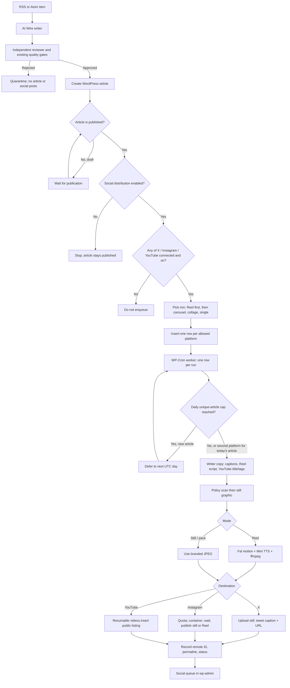
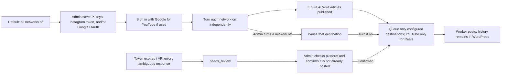

# Social Distribution: Implementation Notes

**Updated:** 10 November 2026  
**Repository:** [HaneetGH/technorapper-ai-wire](https://github.com/HaneetGH/technorapper-ai-wire)  
**Plugin version described:** 0.2.54 (PRs #63 news formats, #64 spoken Reels, #65 YouTube Shorts)  
**Audience:** anyone installing or extending the open-source plugin. This is not an internal worktree log.

Operator costs (OpenAI vs X credits vs Instagram quota vs YouTube Data API quota vs Fal): [What it costs to run](PLATFORM-COSTS.md). Architecture: [Social Distribution Architecture](SOCIAL-DISTRIBUTION-ARCHITECTURE.md).

## Flow diagrams

### Article to social posts

### Switch and credential lifecycle

### Queue states

```mermaid
stateDiagram-v2
    [*] --> queued: article published while enabled and destination configured
    queued --> processing: worker atomically claims row
    processing --> published: platform returns media/post ID
    processing --> queued: image lock busy, Instagram quota, YouTube quota, or video still processing
    processing --> needs_review: API error, stale worker, or outcome may be ambiguous
    needs_review --> queued: Post existing graphic (token refresh; reuse JPEG)
    needs_review --> queued: Generate a new graphic and retry
    [*] --> queued: late platform onboard copies saved graphic onto missing rows
```

## Objective and agreed behavior

Build an opt-in distribution feature for up to **10 unique AI Wire articles per UTC day** on the operator's own X, Instagram, and YouTube accounts. Use one branded still per article (site name from WordPress) and reuse it on X and Instagram stills. Instagram can instead publish a spoken 9:16 Reel of that one article; YouTube uploads the same MP4 as a public Short with title/description/tags set in the Data API. The existing article writer and independent reviewer remain the editorial source of truth; do not add a second article-writing agent.

- The main **Social distribution** switch defaults to off. Off means no new social queue work; it does not unpublish or alter existing WordPress articles.
- Enabling a network queues a site-context job **only after** at least one of X, Instagram, or YouTube is connected. With no social account connected, that job does not run and no OpenAI tokens are spent on context, captions, or social images. When onboarded, the job uses the same Writer model to read this WordPress site (name, tagline, desks, about page, recent stories) and stores a profile later social copy/graphics must follow. The dashboard shows “We are understanding you” while that job runs, the last understood time, and whether a refresh is due (14 days, or if the site identity fingerprint changed).
- Credentials are configured before enabling. Only destinations with complete credentials receive a queue row.
- Only AI Wire-created WordPress `post` articles are eligible. Their `_tr_ai_wire_queue_id` post meta is the source marker.
- Only articles that publish after a network is on **and** that meet the social review-score floor (default 90) are queued. 90 is a complete original article; clustered 85–89 scores with no remaining defect are raised to 90, and one polish pass can apply reviewer fixes. Weaker stories stay on the website. Drafts can be queued if they are later published while that network is on. Connecting a second platform later backfills existing social articles: stills for X/Instagram, spoken Shorts only for YouTube when the article is Reel-mode. Saving credentials does this automatically; the queue has **Queue saved graphics for X/Instagram** and **Queue spoken Shorts for YouTube**. Instagram stills are spaced at least 3 hours apart and captions say link in bio instead of a URL.
- Turning the switch off pauses pending delivery. Turning it on resumes pending rows.
- Daily limit is **unique articles**, so an article's X, Instagram, and YouTube rows all count as one article. The setting is clamped to 1–10. Mix counts (Reel default 0, then carousel default 3, collage, single default 2) decide the format. Captions use a named hook, a save or send ask, and never include generic bait; Reels send `is_ai_generated=true`.
- One social copy package (hook, on-image headline, captions, Reel script, YouTube title/description/tags) is generated from the published article, then one branded graphic. The graphic is cached and reused. If the image budget is zero or exhausted, do not generate a social image or publish a still post without the branded graphic. Reels additionally need the video budget, Fal, and ffmpeg.
- Do not automatically repeat a platform publish when the response is ambiguous. Mark it for review; require an administrator to confirm the post is not already live before retrying. Token-refresh retries (**Post existing graphic**) reuse the saved JPEG. **Generate a new graphic and retry** is a separate action and is the only path that spends image budget again.

## Repository context

AI Wire is a WordPress plugin. RSS ingestion, writing, independent review, SEO preparation, and WordPress publishing already exist. The distribution feature starts **after** the existing publisher has made the article live.

Read these files first:

1. [`README.md`](../README.md): current plugin configuration, publishing architecture, production runbook, and social feature description.
2. [`docs/AI-AGENT-WORKFLOW-AUDIT.md`](AI-AGENT-WORKFLOW-AUDIT.md): writer/reviewer pipeline and publishing behavior.
3. [`docs/PLATFORM-COSTS.md`](PLATFORM-COSTS.md) and [`docs/IMAGE-GENERATION-COST.md`](IMAGE-GENERATION-COST.md): OpenAI vs X credits vs Instagram quota vs YouTube Data API quota, plus image estimates.
4. `includes/class-publisher.php`: AI Wire article creation and `_tr_ai_wire_queue_id` metadata.
5. `includes/class-admin.php`, `includes/class-settings.php`, `includes/class-schema.php`, and `includes/class-plugin.php`: dashboard, settings sanitization, schema upgrade, and hooks.
6. `includes/class-social.php`, `includes/class-social-reel.php`, `includes/class-social-youtube.php`, and `includes/class-youtube-oauth.php`: credentials, queue worker, social copy, branded graphic, Writer-model Reel script, Mini TTS, ffmpeg mux, X/Instagram/YouTube publishing (YouTube title/description/tags via Data API), retries, and queue UI.
7. [`docs/SOCIAL-DISTRIBUTION-ARCHITECTURE.md`](SOCIAL-DISTRIBUTION-ARCHITECTURE.md): editorial vs distribution boundary.

Current plugin compatibility declared in `technorapper-ai-wire.php`: WordPress 6.2+ and PHP 7.4+. The social image renderer additionally requires PHP GD. A TrueType font is optional; the renderer has a built-in GD font fallback.

## Current implementation

- `social_distribution_enabled` default `0`, daily limit default `10`, image budget default `$5`, sanitized and clamped in settings.
- Separate non-autoloaded credentials option for X Keys and tokens, Instagram token/account ID, and YouTube OAuth tokens. Save/remove actions are capability-checked and nonce-protected; the secret is not redisplayed.
- `tr_ai_wire_social` table with a unique `(post_id, platform)` key, independent row states, attempts, image attachment ID, remote ID/URL, and error text.
- `wp_after_insert_post` queueing for published AI Wire posts and a WP-Cron consumer under a worker lock.
- One copy pass writes hook, on-image headline, captions, visual brief, and a spoken Reel script with the **current Writer model**. GPT Image 2 low generates a portrait; GD overlays this WordPress site's name, headline, supporting line and handle as a 1080×1350 JPEG using one of five hashed poster layouts. Same attachment is reused across platforms and is never the article featured image. Instagram format `reel` sends that 9:16 B-roll still to Fal Veo (Lite by default, 8s silent, ~$0.24, $10/month video budget), muxes Mini TTS plus caption overlays, holds the last frame for the rest of the 15–18s voiceover, then a brand sting (`includes/class-social-reel.php`). ffmpeg and a Fal.ai key are required or the job is held. Raise budget/model/length later; do not fall back to a poster slideshow.
- Local monthly social-image estimate at `$0.006` per image, with `$5` default budget. Separate **$10** video budget for Fal. Separate from X API credits, Instagram quota, and YouTube Data API quota.
- X v2 media initialize/append/finalize/status followed by post creation. X credits/plan charges are outside the image budget.
- Instagram Graph API container creation/status/publish, including optional carousel packing of 4–6 website articles, or a collage of those posters.
- YouTube Data API v3 resumable `videos.insert` of the spoken Reel MP4 as a **public** Short (not a draft). Connect with **Sign in with Google**; a YouTube API key cannot upload. Title, description, tags, category, language, license, audience, and synthetic-media disclosure are set in that call. Still images are not posted to YouTube. Off until a channel is connected and posting is on.
- Admin queue: **Post existing graphic**, **Generate a new graphic and retry**, and on published rows **Regenerate graphic and post again** (deletes the live post first).

PHPUnit covers onboarding gates, unique-article daily cap, mocked X publish, Instagram quota deferral, YouTube public listing / no-stills / Google connect URL, and “social asset is not the featured image”. A staging canary with **your** tokens is still required before production enablement. Never commit those tokens.

## API and hosting constraints

### X

- Requires an X developer app with Read and Write access. Prefer the four Keys and tokens values (API Key, API Key Secret, Access Token, Access Token Secret) and sign requests with OAuth 1.0a. The Access Token + Secret popup is not an OAuth 2.0 Bearer token; pasting only that Access Token as Bearer is why posting fails. An OAuth 2.0 user token remains an optional fallback. Tokens can expire or be revoked.
- Image publishing is a multi-step operation: initialize upload, append the file segment, finalize, wait for processing if required, then create the post with the media ID.
- Current image implementation rejects empty or over-5-MB media. The [X chunked media guide](https://docs.x.com/x-api/media/quickstart/media-upload-chunked) documents the v2 flow and `tweet_image`'s typical 5 MB limit.
- Automated posting spends **X developer credits** (or the current X plan’s write allowance). Do not promise a fixed monthly X charge. A queue error of `credits depleted` is X billing, not the OpenAI image budget. Verify in the X Developer Console before enabling.

### Instagram

- Requires a Professional Business or Creator account and a Meta Unified Login configuration with `instagram_content_publish`. The plugin provides a one-time OAuth onboarding flow from the AI Wire admin screen using the Meta Configuration ID and stores the returned system-user token plus Instagram Professional account ID.
- The OAuth callback is `wp-admin/admin-post.php?action=tr_ai_wire_instagram_oauth_callback`; register that exact HTTPS URL as the Meta redirect URL. Meta must also be able to fetch the generated JPEG from a publicly reachable WordPress Media URL. A private, hotlink-blocked, or temporary URL will fail.
- Publishing is a container workflow: create the image container, poll `status_code` until finished, then call `media_publish`. The [Meta Instagram API collection](https://www.postman.com/meta/instagram/documentation/6yqw8pt/instagram-api) and [content publishing guide](https://developers.facebook.com/docs/instagram-platform/content-publishing/) are references.
- Read live quota before submission. The quota endpoint returns usage and a nested configuration; use `quota_usage` against `config.quota_total`. Meta documentation can differ by endpoint/version, so trust the account's response and let Meta enforce the final limit. Quota exhaustion should defer the item, not create a duplicate or fail silently.
- URLs in ordinary Instagram captions are text, not clickable post links.

### YouTube

- Requires **your** Google Cloud OAuth client (YouTube Data API v3 enabled) and **Sign in with Google** (or a pasted refresh token). A YouTube/Google API key cannot upload. Scopes are `youtube.upload` and `youtube.readonly`. Redirect URI is `wp-admin/admin-post.php?action=tr_ai_wire_youtube_oauth_callback`.
- The worker uploads the spoken Reel MP4 bytes. Google does not fetch a WordPress Media URL. Vertical ≤3 minutes is classified as a Short automatically; there is no Shorts flag on `videos.insert`.
- Metadata is API-only and goes live immediately (no Studio draft): `snippet.title` (max 100), `snippet.description` (permalink + `#Shorts` + tag hashtags), `snippet.tags`, `snippet.categoryId`, `snippet.defaultLanguage`, `status.privacyStatus=public`, `status.selfDeclaredMadeForKids=false`, `status.containsSyntheticMedia=true`, `status.license=youtube`, `status.embeddable`, `status.publicStatsViewable`. `publishAt` is never set. If the channel default is private, the worker updates the video to public.
- There is no Google per-upload fee. Default quota is 100 `videos.insert` calls per day. A `quota` Social queue error means the Google Cloud project hit its daily API quota. After a successful byte upload, a processing wait stores the video ID and polls instead of uploading again.

### WordPress and cost

- WP-Cron is traffic-triggered. Configure a host-level cron for timely background delivery.
- PHP GD is required for crop/branding; OpenAI image API access and a working site OpenAI key are required for image generation. Spoken Reels and YouTube Shorts also need `ffmpeg` (usually `ffprobe`) and a Fal.ai key, or those jobs are held.
- At 10 articles/day for 30 days, 300 generated images × `$0.006` local reserve = about **$1.80/month** before retries or provider pricing differences. `$5/month` is the default local image budget. The existing Writer/Reviewer text spend is separate and already exists.
- Social image and Reel storage grows in WordPress Media. X credits, Instagram quota, YouTube quota, and Fal motion are separate meters.
- Image output is an editorial illustration with a deterministic title card; do not ask the image model to render factual text, logos, or a photorealistic depiction of a named news event/person.

## Risks to inspect before release

1. **Duplicate posts after lost responses:** once a platform may have accepted a publish call, never retry automatically. Verify the manual confirmation check covers every ambiguous path.
2. **Daily-cap race and cron concurrency:** keep the queue claim atomic and serialize consumers. Count unique article IDs and use UTC consistently. Verify that a second platform for the same article is still allowed after the unique-article cap is reached.
3. **Long synchronous requests:** image generation can take a long time. Process a bounded number of destination rows per cron execution; ensure timeouts/stale rows move to review safely.
4. **Quota shape and platform version changes:** keep Instagram quota parsing defensive and verify against Meta's current endpoint/version before staging.
5. **Cost drift:** budget uses a fixed local estimate. Provider invoice, retries, rejected output, and X usage can differ. Show this limitation near the control and in docs.
6. **Expired credentials and scopes:** display connection presence without revealing secrets; errors must name the platform and leave operator action clear.
7. **Public image delivery:** confirm WordPress media uses stable HTTPS URLs accessible to Meta, including any CDN, firewall, or hotlink controls.
8. **Content and brand quality:** title overlay can wrap or truncate; review generated cards at actual 1080×1350 size. Ensure the post text is derived from approved SEO/social fields and does not overrun platform limits.
9. **Schema upgrade:** schema v9 must keep the social table without clearing existing AI Wire queue/view data or scheduled feed jobs.
10. **Retry and switch semantics:** turning the switch off pauses queued delivery; it should not delete history or affect already-published platform posts.

## Recommended rollout

### Phase 1 — Review the implementation

- Read `includes/class-social.php` and schema/settings hooks.
- Confirm README, [architecture](SOCIAL-DISTRIBUTION-ARCHITECTURE.md), and [PLATFORM-COSTS.md](PLATFORM-COSTS.md) match the implementation (mix, Reels, Google sign-in, public YouTube listing, X credits, Instagram/YouTube quota).
- Useful tests: default-off, queue idempotency, UTC unique-article cap, disabled pause, quota deferral, ambiguous publish review, and schema preservation.

### Phase 2 — Staging setup

- Use a staging WordPress clone with PHP GD and outbound HTTPS. Configure a real cron runner.
- Add a dedicated X test/developer account, Meta test or otherwise authorized Professional account, and a Google Cloud OAuth client + test YouTube channel if Shorts are on. Keep tokens out of logs and screenshots.
- Check the generated media URL is public from outside the WordPress server.
- Set the distribution switch on only after credentials/scopes and budgets are ready; set daily cap to 1 and a low image budget.

### Phase 3 — Canary and expand

- Publish one AI Wire test article. Verify X and/or Instagram stills (4:5 image, branding, title, link, alt text). If Reels per day is above 0, verify a spoken Instagram Reel and, when YouTube is connected, a **public** Short with title/description/tags — not a Studio draft.
- Test with switch off, missing token, expired token, Instagram quota full, image budget zero/exhausted, a draft later published, and an ambiguous publish response. Confirm no accidental duplicate.
- Observe a one-article/day canary, then increase in steps (for example 3, 5, then 10/day) only after clean queue history and cost review.
- Production enablement is an administrator action. The switch remains off by default in the plugin.

## Acceptance criteria

- [ ] New installations and upgrades default Social distribution to off; no social API calls or social images occur while off.
- [ ] Admin can save, replace, and remove platform credentials; secrets are not echoed in the page; actions require an admin capability and nonce.
- [ ] Enabling with credentials queues only future published AI Wire articles and creates at most one row per `(article, platform)`.
- [ ] A daily limit from 1 through 10 caps unique articles per UTC day, while all configured destinations for an already-counted article can finish.
- [ ] One GPT Image 2 low image is generated and branded per eligible article, then reused by its platform rows and stored in WordPress Media.
- [ ] Local monthly image budget is separate from Writer/Reviewer spend and blocks future image requests at the configured estimate.
- [ ] X receives an image and concise post text with the article URL; X upload and post failures show a useful status.
- [ ] Instagram receives a publicly reachable JPEG or Reel MP4, valid caption and alt text; quota is read from the API and a full quota defers publishing.
- [ ] YouTube receives the spoken MP4 as a public Short with API title, description, and tags; an API key cannot authenticate uploads; quota defers publishing.
- [ ] Success stores remote IDs/URLs. Platform/API errors are visible. Ambiguous outcomes require human verification before retry.
- [ ] Switch off pauses queued items without deleting queue history or changing posts already live on the platforms.
- [ ] Schema upgrade preserves all existing plugin data and feed cron behavior.
- [ ] README, architecture, cost estimate, and staging checklist describe the actual behavior and explicitly call out WP-Cron, PHP GD, ffmpeg, public media URLs, expiring tokens, X credits, Instagram quota, YouTube quota, and Google sign-in.
- [ ] Staging canary with **this operator's** accounts passes before the feature is enabled on production. Tokens stay off git.
